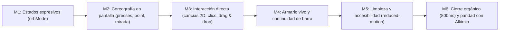

# Plan de implementación — Mejora de animaciones e interacciones de la mascota

> **Propósito:** Plan autocontenido para mejorar las animaciones, expresiones e interacciones de la mascota en `src/app/features/assistant/`.
> **Regla por fase:** Cada fase debe dejar en verde `npm run build`, `npm run lint` y `npx ng test --watch=false --include="src/app/features/assistant/**/*.spec.ts"`.
> **Restricción de arquitectura:** Mantener Angular v20+ standalone con `ChangeDetectionStrategy.OnPush`, signals, funciones geométricas/coreográficas puras separadas del DOM (para tests unitarios rápidos sin montar navegador pesado) y respeto estricto a `prefers-reduced-motion: reduce`.

---

## 0. Contexto y brechas detectadas en el código actual

| # | Brecha detectada | Ubicación exacta | Impacto actual |
|---|---|---|---|
| **B1** | **8 de los 12 modos de `MascotMode` nunca se activan** | `src/app/features/assistant/mascot-state.service.ts` (L198–203) vs `src/app/features/assistant/components/mascot-orb.ts` (L258–285) | `MascotOrb.eyesOf()` soporta 12 modos (`idle`, `listening`, `thinking`, `acting`, `confirm`, `paused`, `done`, `reading`, `wardrobe`, `happy`, `confused`, `sleeping`), pero `orbMode()` solo devuelve 4 (`thinking`, `confirm`, `listening`, `idle`). |
| **B2** | **`sending()` eclipsa a `paused`, `confirm` y `acting`** | `src/app/features/assistant/mascot-state.service.ts` (L198–203) y `src/app/features/assistant/mascot/mascot-life.service.ts` (L182) | Como `if (this.sending()) return 'thinking'` va primero, durante un turno en streaming la mascota nunca pasa a `paused` (cuando `cursor.paused()` es `true`), ni a `confirm` (cuando espera respuesta en `questions.current()` o `pendingAction()`), ni a `acting` (mientras rellena campos o ejecuta tools). Además, como `MascotLifeService` comprueba `mode === 'confirm'` para sacar el móvil tras `PHONE_AFTER_MS` (20 s), **nunca saca el móvil esperando una pregunta en vivo**. |
| **B3** | **`fill.presses` se incrementa en 5 sitios pero nadie lo pinta** | `src/app/features/assistant/mascot/fill/mascot-fill.service.ts` (L37–38), `src/app/features/assistant/mascot/fill/animated-fill.ts` (L236, L252, L316, L341), `src/app/features/assistant/copilot/tools/press.run.ts` (L81) | `presses = signal(0)` dice *"Sube en cada pulsación, para que el anillo se repita aunque sean dos seguidas"*, pero ningún componente lo consume. No hay feedback visual de toque cuando la mascota pulsa botones o enfoca campos. |
| **B4** | **`point_at` y `show_around` no resaltan el control señalado** | `src/app/features/assistant/copilot/tools/point.run.ts` (L28–36), `src/app/features/assistant/copilot/tools/tour.run.ts` (L58–65) | `playHighlight` aplica `data-mascot-highlight` (`HIGHLIGHT_ATTR`), pero `runPointAt` y `runShowAround` solo viajan hasta el control sin encender el latido `[data-mascot-highlight]`. |
| **B5** | **Mirada fija e impersonal al rellenar/señalar campos y corte de `.mascot-doing`** | `src/app/features/assistant/mascot/placement.ts` (L71–88), `src/app/features/assistant/components/mascot-launcher.ts` (L46–57, L167–181) | La mascota se coloca a la izquierda o derecha del campo (`orbBeside`), pero sus pupilas no miran hacia el control objetivo y el bocadillo `.mascot-doing` (`bottom: 94px`) se sale por arriba del viewport si el campo está cerca del borde superior (`top < 90px`). |
| **B6** | **Interacciones directas con el orbe limitadas o bloqueadas** | `src/app/features/assistant/mascot/lifeDetectors.ts` (L43–81), `src/app/features/assistant/components/mascot-launcher.ts` (L297–299) | 1) `PettingDetector` solo mide `clientX` (ignora caricias verticales/diagonales). 2) Con la barra abierta, hacer clic en la mascota acoplada no da ningún feedback hasta el 5.º clic (`CLICK_BURST`). 3) `.mascot-fab--catching { transform: scale(1.12); }` es pisado por `[style.transform]="fabTransform()"` inline y solo se activa sobre los 62 px del botón. |
| **B7** | **El orbe del escenario en `MascotWardrobe` está dormido e inerte** | `src/app/features/assistant/components/mascot-wardrobe.ts` (L58) | Usa `[decorative]="true"` y `mode="idle"`, por lo que tiene los ojos cerrados (`SHUT`), no parpadea y al elegir una fruta en el estante no enseña su personalidad (`PERSONALITIES`). |
| **B8** | **Cortes secos al cerrar `MascotBar` y CSS duplicado** | `src/app/features/assistant/bar/mascot-bar.html` (L1), `src/app/features/assistant/components/mascot-launcher.ts` (L238–250 y L354–366) | La barra se desenrolla en 500 ms al abrir, pero desaparece en 0 ms al cerrar mientras el FAB viaja 500 ms solo hacia la esquina. Además, `.mascot-cape` está duplicado en `mascot-launcher.ts`. |

---

## Mapa de fases

---

## Fase M1 — Conectar todos los estados expresivos (`MascotMode`)

**Objetivo:** Que `MascotStateService.orbMode()` refleje con precisión qué está haciendo la mascota en cada momento del turno y desbloquee los temporizadores de espera de `MascotLifeService`.

| # | Tarea | Ficheros | Especificación detallada |
|---|---|---|---|
| **M1.1** | **Jerarquía completa en `orbMode()`** | `src/app/features/assistant/mascot-state.service.ts` (L198–203) | Actualizar `orbMode = computed<MascotMode>(...)` con este orden estricto de prioridad: 1. `if (this.wardrobeOpen()) return 'wardrobe';` 2. `if (this.cursor.paused()) return 'paused';` 3. `if (this.pendingAction() !== null || this.questions.current() !== null) return 'confirm';` 4. `if (this.uploading()) return 'reading';` 5. `if (this.fill.filling() || this.runner.running() !== null) return 'acting';` 6. `if (this.sending()) return 'thinking';` 7. `if (this.transientMode()) return this.transientMode()!;` *(ver M1.2)* 8. `if (this.open()) return 'listening';` 9. `return 'idle';` |
| **M1.2** | **Estados transitorios `done` y `confused` tras rellenar** | `src/app/features/assistant/mascot/fill/mascot-fill.service.ts`, `src/app/features/assistant/mascot/fill/animated-fill.ts`, `src/app/features/assistant/mascot-state.service.ts` | Añadir un estado transitorio breve al finalizar `playFill`: - Cuando termina con `rejected.length > 0` o `(missing.length > 0 && written.length === 0)`, activar `'confused'` durante `1600 ms`. - Cuando termina con `written.length > 0 && rejected.length === 0`, activar `'done'` durante `1400 ms`. |
| **M1.3** | **Despertar atención al hacer preguntas** | `src/app/features/assistant/copilot/question.service.ts` (L67–83) | Al pasar `orbMode()` a `'confirm'` durante `questions.current()`, `MascotLifeService` ya activará automáticamente `waiting = mode === 'confirm'` y sacará el teléfono tras `PHONE_AFTER_MS` (20 s). Asegurar que cuando el usuario responde (`answer()` / `decline()`), `MascotLifeService` limpia el teléfono inmediatamente al cambiar `mode`. |

**Tests requeridos (M1):**
- Ampliar `src/app/features/assistant/mascot-state.service.spec.ts`:
  - Verificar que con `sending() === true` y `cursor.paused() === true`, `orbMode()` es `'paused'`.
  - Verificar que con `sending() === true` y `questions.current() !== null` (o `pendingAction() !== null`), `orbMode()` es `'confirm'`.
  - Verificar que con `sending() === true` y `fill.filling() === true`, `orbMode()` es `'acting'`.
  - Verificar que con `uploading() === true`, `orbMode()` es `'reading'`.
- En `src/app/features/assistant/mascot/mascot-life.service.spec.ts`: comprobar que en modo `'confirm'` tras `PHONE_AFTER_MS` `life()` emite `{ kind: 'phone', glance: false }`.

---

## Fase M2 — Coreografía en pantalla: anillo de pulsación, resaltado y dirección de mirada

**Objetivo:** Conectar la señal huérfana `fill.presses()`, resaltar los controles señalados en `point_at` / `show_around`, orientar la mirada hacia el control activo y evitar que el bocadillo `.mascot-doing` se corte en el borde superior.

| # | Tarea | Ficheros | Especificación detallada |
|---|---|---|---|
| **M2.1** | **Anillo e impulso físico al pulsar (`fill.presses`)** | `src/app/features/assistant/components/mascot-launcher.ts` | Consumir `fill.presses()` en `MascotLauncher`: - Cuando `fill.presses()` incrementa (`> 0`), renderizar/reiniciar un `` dentro de `.mascot-fab` que se expande de `scale(0.8)` a `scale(1.65)` con `opacity: 0.7 -> 0` en `380 ms ease-out` (borde de `2px solid var(--primary)`). - Usar el valor de `fill.presses()` para que dos pulsaciones seguidas repitan el anillo fielmente. - Con `prefers-reduced-motion: reduce`, no animar escala (`animation: none`). |
| **M2.2** | **Resaltado `data-mascot-highlight` en `point_at` y `show_around`** | `src/app/features/assistant/copilot/tools/point.run.ts` (L28–36), `src/app/features/assistant/copilot/tools/tour.run.ts` (L58–65) | En `runPointAt` y en cada parada de `runShowAround`, una vez que `goToElement(found.element, ...)` devuelve `true`: - Aplicar `found.element.setAttribute(HIGHLIGHT_ATTR, '')` dentro de `try { await fill.wait(...); } finally { found.element.removeAttribute(HIGHLIGHT_ATTR); }`, igual que en `playHighlight` (`animated-fill.ts` L476–481). |
| **M2.3** | **Orientar la mirada hacia el campo o control objetivo** | `src/app/features/assistant/mascot/placement.ts` (L38–88), `src/app/features/assistant/components/mascot-orb.ts` (L266–267), `src/app/features/assistant/components/mascot-launcher.ts` | 1. En `placement.ts`, añadir una función pura `lookSide(spot: Spot, field: Box): -1 | 1` que devuelva `1` si el centro del campo está a la derecha del centro del orbe y `-1` si está a su izquierda. 2. Añadir un input opcional `lookX = input<-1 | 0 | 1>(0)` en `MascotOrb`. 3. En `MascotOrb.eyesOf('acting')`, usar `pair(bar(1, this.lookX() * 2.5, 0))` en lugar de `pair(bar(1))` para que la mascota mire hacia el campo que está escribiendo o señalando. |
| **M2.4** | **Reposicionar `.mascot-doing` cerca del techo del viewport** | `src/app/features/assistant/components/mascot-launcher.ts` (L115–120, L167–181) | En `MascotLauncher`, calcular una señal `doingBelow = computed(...)` que sea `true` cuando el destino del viaje deje el orbe a menos de `88 px` del borde superior de la ventana (`spot.top < 88`). Añadir `[class.mascot-doing--below]="doingBelow()"` para que cuando esté cerca del techo el bocadillo se pinte justo debajo del orbe y nunca quede recortado fuera de la ventana. |

**Tests requeridos (M2):**
- `src/app/features/assistant/copilot/tools/point.run.spec.ts` y `tour.run.spec.ts`: verificar que `found.element.hasAttribute('data-mascot-highlight')` es `true` durante la espera y se limpia en `finally` (incluso si se aborta la señal).
- `src/app/features/assistant/mascot/placement.spec.ts`: probar `lookSide` (`1` cuando la mascota se coloca a la izquierda del campo, `-1` cuando se coloca a la derecha).
- `src/app/features/assistant/components/mascot-launcher.spec.ts`: verificar que al incrementar `fill.presses()` se renderiza `.mascot-press-ring`.

---

## Fase M3 — Interacciones directas con el orbe (caricias 2D, toque acoplado y Drag & Drop)

**Objetivo:** Hacer que las interacciones físicas con el cursor o archivos sobre la mascota respondan de forma natural en cualquier dirección y estado.

| # | Tarea | Ficheros | Especificación detallada |
|---|---|---|---|
| **M3.1** | **`PettingDetector` en 2D** | `src/app/features/assistant/mascot/lifeDetectors.ts` (L36–82), `src/app/features/assistant/mascot/mascot-life.service.ts` (L260–266), `src/app/features/assistant/components/mascot-orb.ts` (L212–215) | Ampliar `PettingDetector.move(x: number, now: number, y?: number): boolean` (manteniendo `y = 0` por defecto para retrocompatibilidad con tests existentes): - Calcular el vector `(dx, dy)` respecto al `anchor: { x, y }`. - Si la distancia recorrida `Math.hypot(dx, dy) >= config.minTravel`, comprobar el producto escalar `dx * prevDx + dy * prevDy < 0` para detectar una reversión de dirección en cualquier ángulo (horizontal, vertical o diagonal). - Pasar `event.clientX, event.clientY` desde `MascotOrb.onMove()`. |
| **M3.2** | **Micro-reacción al pulsar la mascota cuando la barra ya está abierta** | `src/app/features/assistant/mascot-state.service.ts` (L327–330) | Hoy, cuando `state.open()` es `true`, `state.toggle()` hace `return` sin hacer nada, por lo que los primeros 4 clics parecen muertos hasta que el 5.º dispara `dizzy`. - En `MascotStateService.toggle()`: si `this.open()` ya es `true`, llamar a `this.mood.feel('highfive', 700)` para que tocarla con el panel abierto dé respuesta inmediata, sin impedir que 5 clics rápidos sigan activando `dizzy` en `MascotOrb.onClick()`. |
| **M3.3** | **Arreglar el escalado de `catching` y anticipar el Drag & Drop** | `src/app/features/assistant/components/mascot-launcher.ts` (L127–132, L297–299) | 1. En `MascotLauncher`, `.mascot-fab--catching { transform: scale(1.12); }` es ignorado cuando `[style.transform]="fabTransform()"` aplica un transform inline (por ejemplo, cuando está acoplada o en pose). Mover el escalado a `.mascot-fab--catching app-mascot-orb { transform: scale(1.14); transition: transform 180ms cubic-bezier(0.2, 0.8, 0.3, 1); }` para que nunca colisione con `fabTransform()`. 2. Escuchar `dragenter`/`dragleave`/`drop` de archivos (`dataTransfer?.types?.includes('Files')`) a nivel de `document` en `MascotLauncher` (limpiado con `DestroyRef`): mientras el usuario arrastra un archivo por la ventana, despertar a la mascota (`life.attend()`) y mostrar una clase `.mascot-fab--file-near` con un realce sutil que invite a soltarle el archivo encima. |

**Tests requeridos (M3):**
- `src/app/features/assistant/mascot/lifeDetectors.spec.ts`: mantener los tests horizontales existentes y añadir tests para caricias verticales (`x` fijo, `y` alternando) y diagonales.
- `src/app/features/assistant/components/mascot-launcher.spec.ts`: comprobar que arrastrar un archivo aplica `.mascot-fab--catching` sin perder `fabTransform()`.

---

## Fase M4 — Armario vivo (`MascotWardrobe`) y continuidad en `MascotBar`

**Objetivo:** Que el probador del armario muestre a la mascota viva y enseñe el carácter de cada fruta al probarla, y que la barra inferior suavice la aparición de sus bloques internos.

| # | Tarea | Ficheros | Especificación detallada |
|---|---|---|---|
| **M4.1** | **Despertar el modelo del escenario en `MascotWardrobe` y previsualizar su personalidad** | `src/app/features/assistant/components/mascot-wardrobe.ts` (L57–59), `src/app/features/assistant/components/mascot-orb.ts` | 1. En `MascotOrb`, añadir un input opcional `previewScene = input<Scene | null>(null)` que tenga prioridad en `scene()` y `eyes()` incluso cuando `[decorative]="true"`, sin alterar el singleton `MascotLifeService`. 2. En `MascotWardrobe`, pasar `[mode]="'wardrobe'"` al `<app-mascot-orb>` grande del escenario (`.wd-model`) para que tenga los ojos abiertos (`bar(1, 0, 1)`) y parpadee (`blink = 1`) en lugar de estar dormido (`SHUT`). 3. En `MascotWardrobe`, cada vez que el usuario selecciona una fruta distinta en el estante o con las flechas (`pick.set(...)`), activar `previewScene.set('blush')` durante `1800 ms` en el orbe del escenario. Así cada fruta ejecuta su `happyMove` (`sway`, `hop`, `preen`, `still`) y sus `happyBits` (`heart`, `star`, `both`, `none`) definidos en `personalities.ts`. |
| **M4.2** | **Entrada suave de bloques internos en `MascotBar`** | `src/app/features/assistant/bar/mascot-bar.scss` (L59–160) | Añadir en `mascot-bar.scss` una micro-animación de entrada (`160 ms var(--motion-ease-out)`) para los bloques dinámicos dentro de `.card__body` (`.say`, `.doing`, `.consent`, `.first`, `app-mascot-action-card`) para suavizar el cambio cuando la tarjeta pasa de pastilla (`.card--pill`) a mostrar contenido, desactivándola bajo `@media (prefers-reduced-motion: reduce)`. |

**Tests requeridos (M4):**
- `src/app/features/assistant/components/mascot-wardrobe.spec.ts`: verificar que el orbe del escenario recibe `mode="wardrobe"` y que al cambiar de skin se activa `previewScene="blush"` temporalmente y se limpia tras el timeout.

---

## Fase M5 — Limpieza técnica y accesibilidad (`prefers-reduced-motion`)

**Objetivo:** Eliminar duplicidades CSS y garantizar que todas las mejoras nuevas respetan `prefers-reduced-motion: reduce`.

| # | Tarea | Ficheros | Especificación detallada |
|---|---|---|---|
| **M5.1** | **Eliminar CSS duplicado en `MascotLauncher`** | `src/app/features/assistant/components/mascot-launcher.ts` (L353–366) | Eliminar el bloque `.mascot-cape` duplicado dentro de `@media (max-width: 640px)` (líneas 353–366), que es idéntico al de las líneas 237–250. |
| **M5.2** | **Auditoría `prefers-reduced-motion` y verificación final** | `src/app/features/assistant/components/mascot-launcher.ts`, `src/app/features/assistant/bar/mascot-bar.scss`, `src/app/features/assistant/components/mascot-orb.ts` | Verificar que bajo `@media (prefers-reduced-motion: reduce)`: - `.mascot-press-ring` y `.mascot-fab--catching app-mascot-orb` no escalan espacialmente. - Las animaciones de `.card__body` tienen `animation: none`. - `MascotOrb` con `previewScene` en el armario aplica la pose estática (`!m.on` en `agentMotion.ts`) sin bucles infinitos. - Ejecutar `npm run build`, `npm run lint` y `npx ng test --watch=false --include="src/app/features/assistant/**/*.spec.ts"`. |

---

## Fase M6 — Cierre orgánico (`800 ms`) y paridad de vida e interacción con Alkimia

**Objetivo:** Eliminar el corte instantáneo (`0 ms`) al cerrar la barra/mascota e incorporar las mejoras de movimiento orgánico, expresión e interacción de referencia en `/home/ivan/IdeaProjects/alkimia-app/src/core/copilot`.

| # | Tarea | Ficheros | Especificación detallada (referencia Alkimia) |
|---|---|---|---|
| **M6.1** | **Viaje orgánico de `800 ms` en ambos sentidos (abrir y cerrar) + transición permanente en `.mascot-fab`** | `src/app/features/assistant/components/mascot-launcher.ts`, `src/app/features/assistant/bar/mascot-bar.ts`, `src/app/features/assistant/bar/mascot-bar.html`, `src/app/features/assistant/bar/mascot-bar.scss` | **Referencia:** `CopilotMascot.tsx` (`TRAVEL_MS = 800`, `cubic-bezier(0.45, 0, 0.2, 1)`) y `usePresence.ts`. 1. **Bug actual:** En `mascot-launcher.ts`, `transition: right ..., bottom ...` solo está en `.mascot-fab.mascot-fab--docked:not(.mascot-fab--travelling)`. Al quitar `.mascot-fab--docked` al cerrar, `.mascot-fab` no tiene transición en `right`/`bottom` y salta en `0 ms`. Además, `@if (state.barOpen())` destruye la barra en `0 ms`. 2. **Solución en `.mascot-fab`:** Declarar la transición de `right` y `bottom` en la regla base `.mascot-fab:not(.mascot-fab--travelling)` con `--mascot-travel: 800ms` y curva `cubic-bezier(0.45, 0, 0.2, 1)`: `transition: right var(--mascot-travel, 800ms) cubic-bezier(0.45, 0, 0.2, 1), bottom var(--mascot-travel, 800ms) cubic-bezier(0.45, 0, 0.2, 1), transform var(--mascot-pose, var(--motion-duration-fast, 150ms) var(--motion-ease-out, ease-out));` 3. **Plegado orgánico de `MascotBar` al cerrar (`leaving`):** En `MascotBar`, no desmontar el DOM instantáneamente cuando `state.barOpen()` pasa a `false`. Mantener señales `barMounted` y `barLeaving`: - Cuando `state.barOpen()` pasa de `true` a `false`, activar `barLeaving = true` durante `720 ms` (0 ms si `prefers-reduced-motion: reduce`) antes de poner `barMounted = false` y llamar a `publishDock(null)`. - En `mascot-bar.scss`, subir `--mascot-bar-in` a `750ms cubic-bezier(0.2, 0.7, 0.2, 1)` y añadir `.card--leaving` con `pointer-events: none` y `@keyframes mascot-bar-out` (`720ms cubic-bezier(0.45, 0, 0.2, 1) forwards`: de `clip-path: inset(0 0 0 0 round 20px); opacity: 1` a `clip-path: inset(0 0 0 88% round 20px); opacity: 0; transform: translateY(4px)`), de modo que la tarjeta se enrolle hacia la esquina derecha al mismo ritmo que la mascota regresa a su rincón. 4. **Asentamiento físico al llegar a la esquina:** Cuando `state.barOpen()` pasa de `true` a `false` (regreso a la esquina), al aterrizar (~`760 ms`) disparar un micro-rebote de asentamiento en el cuerpo o `follow` (`squash: [1.12, 0.88]` -> `[1, 1]` con spring `cubic-bezier(0.34, 1.5, 0.6, 1)`) y mantener `pointer-events: none` en tránsito (`passing`) para no interceptar clics sobre el botón de ocultar. |
| **M6.2** | **Anillo punteado en el hueco de la barra cuando la mascota sale a trabajar (`isAway`)** | `src/app/features/assistant/bar/mascot-bar.ts`, `src/app/features/assistant/bar/mascot-bar.html`, `src/app/features/assistant/bar/mascot-bar.scss` | **Referencia:** `MascotBar.tsx` (L205–212). - Cuando la barra está abierta y la mascota ha salido de su acople para viajar a un control (`fill.filling() || fill.target() !== null`), renderizar dentro de `.card` un `` (círculo de `44px`, `border: 1.5px dashed var(--line-strong, #cddcee)`, `border-radius: 50%`, centrado verticalmente con la fila `.input`) que indica visualmente que la mascota ha salido de su asiento y volverá ahí. |
| **M6.3** | **Plegado de la fila de input mientras trabaja (`folded`) y encogimiento si tapa el campo (`overlapsBar`)** | `src/app/features/assistant/bar/mascot-bar.ts`, `src/app/features/assistant/bar/mascot-bar.html`, `src/app/features/assistant/bar/mascot-bar.scss`, `src/app/features/assistant/mascot/placement.ts` | **Referencia:** `MascotBar.tsx` (L143–145), `BarInput.tsx` (L52–54) y `placement.ts` (`overlapsBar`, L115–124). 1. En `placement.ts`, añadir la función pura `overlapsBar(field: Box, bar: { width: number; height: number }, viewport: Viewport): boolean` que comprueba si el campo activo queda debajo del área de la barra. 2. En `MascotBar`, si `working()` es `true` y `overlapsBar` es `true`, aplicar `.card--compact` (`width: min(400px, calc(100vw - 32px))`). 3. En `MascotBar`, calcular `folded = computed(() => this.working() && !this.asking() && !this.hover() && !this.focusIn() && this.text().trim() === '' && this.state.attachment() === null)`. Cuando `folded()` es `true`, aplicar `.input--folded` (`max-height: 0; min-height: 0; padding-top: 0; padding-bottom: 0; opacity: 0; overflow: hidden; pointer-events: none; transition: max-height 280ms cubic-bezier(0.2, 0.7, 0.2, 1), padding 280ms cubic-bezier(0.2, 0.7, 0.2, 1), opacity 200ms ease`) y acoplar la mascota (`dockPoint`) a la fila visible (`.doing` cuando `.input` está plegado, o `.input` cuando está desplegado). Al pasar el ratón por la tarjeta (`mouseenter`) o enfocar, se despliega suavemente. |
| **M6.4** | **Clic contextual sobre la mascota según lo que hace (`pressMascot`)** | `src/app/features/assistant/mascot-state.service.ts` (`toggle()`), `src/app/features/assistant/bar/mascot-bar.ts` | **Referencia:** `CopilotMascot.tsx` (`pressMascot`, L209–227). Actualizar `MascotStateService.toggle()`: - Si `wardrobeOpen()` o `orbMode() === 'confirm'`, no hacer nada. - Si `orbMode() === 'acting' || orbMode() === 'thinking' || orbMode() === 'paused'`, alternar la pausa del trabajo: `this.cursor.toggle()` (así pulsar la mascota mientras rellena o piensa sirve de botón directo de pausa/reanudar). - Si `orbMode() === 'done'` o el humor actual es `'cheer'` / `'highfive'`, llamar a `this.mood.feel('highfive', 700)`. - Si `this.open()` ya es `true` (`listening` / `reading`), hacer `this.mood.feel('highfive', 700)` y enfocar el `textarea` de la barra (`[data-mascot-bar-input]`). - En caso contrario (`idle`), abrir el panel (`this.openPanel()`). |
| **M6.5** | **Badges de estado en `MascotOrb` (`?`, `⏸`, condiciones) y destello radial al cambiar de skin (`mascot-skin-burst`)** | `src/app/features/assistant/components/mascot-orb.ts`, `src/app/features/assistant/components/mascot-orb.html`, `src/app/features/assistant/components/mascot-orb.scss` | **Referencia:** `MascotOrb.tsx` (L267, L297, L304–314) y `mascot.css` (L93–133, L562–590). 1. En `mascot-orb.html` (cuando `!still()`): - Si `mode() === 'confirm'`, pintar `?` (círculo `18px` arriba a la derecha `top: -4px; right: -4px`, fondo `#44d297`, texto `#1b272c`, borde blanco `2px`, animación `mascot-pop 220ms ease-out`). - Si `mode() === 'paused'`, pintar `<i></i><i></i>` (dos barras verticales de pausa). 2. Cuando cambia `skin()` en un orbe no estático (`!still()`), disparar un contador `skinPulse` que renderiza `` con la animación `mascot-skin-burst 750ms ease-out both` (`scale(0.2) opacity(1)` -> `scale(2.6) opacity(0)` con gradiente radial cálido). |
| **M6.6** | **Mirada 2D (`gazeToward`) en `acting`/`confirm` y cejas de disculpa en `worried`** | `src/app/features/assistant/mascot/placement.ts`, `src/app/features/assistant/components/mascot-orb.ts`, `src/app/features/assistant/components/mascot-orb.html`, `src/app/features/assistant/components/mascot-launcher.ts` | **Referencia:** `placement.ts` (`gazeToward`, L127–133) y `MascotOrb.tsx` (L41–46, L278–288). 1. En `placement.ts`, añadir `gazeToward(spot: Spot, field: Box | null): { dx: number; dy: number }` (calculando el vector normalizado hacia el centro de la primera línea del campo: `dx = Math.round((vx / length) * 4)`, `dy = Math.round((vy / length) * 3)`). Mantener `lookSide` por retrocompatibilidad. 2. En `MascotOrb`, añadir `gaze = input<{ dx: number; dy: number }>({ dx: 0, dy: 0 })` (o combinarlo con `lookX` como fallback) y usarlo en `eyesOf('acting')` y `eyesOf('confirm')` cuando `gaze` sea distinto de `{0, 0}`. 3. En `MascotOrb`, mostrar cejas también cuando `mood() === 'worried'`, con inclinación de preocupación (`browShape`: inclinadas hacia arriba en el centro, opacidad `0.8`), distinguiéndolas del ceño fruncido de `angry`. |
| **M6.7** | **Armario (`MascotWardrobe`): *dip* al elegir fruta, celebración al confirmar (`wardDone`) y *twitch* de orejas** | `src/app/features/assistant/components/mascot-wardrobe.ts`, `src/app/features/assistant/components/mascot-orb.scss` | **Referencia:** `CopilotMascot.tsx` (`useDip`, L174–183), `mascotStore.ts` (`WARDROBE_DONE_MS = 900`, L181, L211–218) y `mascot.css` (`copilot-mascot-ear-twitch`, L338–397). 1. En `MascotWardrobe.choose(id)`: activar una señal `dip = signal(false)` a `true` durante `160 ms` que aplica `.wd-model--dip` (`transform: scale(0.84); transition: transform 150ms cubic-bezier(0.2, 0.8, 0.3, 1)`), dando peso físico al cambio de fruta además de `previewScene('blush')` y el destello `mascot-burst`. 2. En `MascotWardrobe.confirm()`: guardar el look (`this.look.setLook(...)`), cambiar el modo del orbe del escenario a `'done'` (ojos en arco feliz `ARCH`) y cerrar tras `450 ms` (0 ms en `prefers-reduced-motion: reduce` o en llamadas síncronas si procede) o hacer que al cerrarse el armario el FAB principal celebre con `mood.feel('cheer', 1400)`. 3. En `mascot-orb.scss`, añadir una micro-animación asíncrona de *twitch* sutil a las orejas (`[data-ears] path`, cada `7s` en `:not(.is-still)` y desactivada en `prefers-reduced-motion: reduce`). |
| **M6.8** | **Bocadillos con cola apuntando a la mascota y orientación dinámica en el viewport** | `src/app/features/assistant/components/mascot-launcher.ts` | **Referencia:** `MascotSpeech.tsx` (L25–53) y `MascotNote.tsx` (L83–87). 1. Añadir la cola romboidal (`::after` de `10px x 10px`, `transform: rotate(45deg)`) tanto a `.mascot-note` como a `.mascot-doing` apuntando hacia la mascota (abajo en modo normal, arriba cuando `.mascot-doing--below` está activo). 2. Cuando la mascota viaja a la parte izquierda de la pantalla (`spot.left < 220`), alinear `.mascot-doing` hacia la derecha del orbe para que nunca se corte por el borde izquierdo del viewport. 3. Si la mascota está fuera de su esquina (`fill.target() !== null`) esperando una pregunta (`state.questions.current()`), mostrar el texto de la pregunta en el bocadillo sobre la mascota. |
| **M6.9** | **Detección real de ausencia (`AWAY_AFTER_MS = 120_000`) y bienvenida al regresar (`WELCOME_AFTER_MS = 300_000`)** | `src/app/features/assistant/components/mascot-orb.ts`, `src/app/features/assistant/mascot/mascot-life.service.ts`, `src/app/features/assistant/mascot/mascot-mood.service.ts` | **Referencia:** `useAway.ts` (`AWAY_AFTER_MS = 120_000`) y `useMascotSignals.ts` (`WELCOME_AFTER_MS = 5 * 60_000`). 1. Además de `document.visibilityState === 'hidden'`, considerar `away = true` tras `120_000 ms` sin actividad de usuario (`pointermove`, `pointerdown`, `keydown`, `wheel`, `touchstart` con `{ passive: true }`). 2. Cuando `away` vuelve a `false` tras haber estado ausente al menos `5 min` (`300_000 ms`) y la mascota está libre (`idle` o `listening`), disparar `mood.feel('welcome')`. |
| **M6.10** | **Tooltip de reposo (`RestHint`) y anillo de foco solo para teclado (`data-pointer-focus`)** | `src/app/features/assistant/components/mascot-launcher.ts`, `src/assets/i18n/es.json`, `src/assets/i18n/en.json` | **Referencia:** `CopilotMascot.tsx` (`RestHint` L116–126, `POINTER_FOCUS_ATTR` L248–265). 1. Cuando la mascota está en `idle` en su esquina (sin nota abierta, sin volar y sin barra abierta) y el usuario pasa el ratón por encima (`hover`) o acerca un archivo (`catching` / `fileNear`), mostrar a su izquierda una píldora `.mascot-hint` (`assistant.attachment_drop` si hay archivo, o `state.name()` / `assistant.placeholder` en reposo). 2. Marcar `data-pointer-focus` en `pointerdown` sobre `.mascot-fab` y limpiarlo en `keydown` / `blur` para que el `outline` de `:focus-visible` solo se pinte al navegar con teclado (`Tab`) y no quede un recuadro tras hacer clic con el ratón. |

**Tests requeridos (M6):**
- `src/app/features/assistant/components/mascot-launcher.spec.ts`:
  - Verificar que `.mascot-fab` conserva la transición de `800ms` en su regla base al desacoplarse (cierre no instantáneo).
  - Verificar que al pulsar la mascota en modo `'acting'` o `'thinking'` se alterna `cursor.paused()`.
  - Verificar que `data-pointer-focus` se añade en `pointerdown` y se limpia en `blur`/`keydown`.
  - Verificar el renderizado de `.mascot-hint` al arrastrar archivos o hacer hover en reposo.
- `src/app/features/assistant/bar/mascot-bar.spec.ts` (o ampliar tests de la barra):
  - Verificar que al pasar `state.barOpen()` de `true` a `false`, la tarjeta entra en `.card--leaving` antes de desmontarse del DOM.
  - Verificar que cuando la mascota viaja a un campo (`fill.filling() === true`), se pinta `.card__dock-ghost` en el hueco izquierdo de la barra y la fila `.input` se pliega (`.input--folded`) hasta que el usuario hace `mouseenter` o enfoca el input.
- `src/app/features/assistant/mascot/placement.spec.ts`:
  - Probar `gazeToward` (mirada 2D `{ dx, dy }`) y `overlapsBar`.
- `src/app/features/assistant/components/mascot-orb.spec.ts` (o `mascot-wardrobe.spec.ts`):
  - Verificar los badges `[data-badge="ask"]` en modo `'confirm'` y `[data-badge="paused"]` en modo `'paused'`, las cejas en `mood === 'worried'`, y el destello `.mascot-burst` al cambiar de skin.

---

## Fase M7 — Impeccable Polish (`DESIGN.md` "The Quiet Clinic" y `craft-floor`)

**Objetivo:** Pulir los desvíos del sistema de diseño (`DESIGN.md`), accesibilidad de teclado/foco, áreas de toque, responsividad móvil/tablet, tipografía (`11.5px` floor) y limpieza de código detectados en la auditoría `/impeccable polish`.

| # | Tarea | Ficheros | Especificación detallada |
|---|---|---|---|
| **M7.1** | **Compactación real en CSS de `MascotBar` (`is-compact` / `.card--compact`)** | `src/app/features/assistant/bar/mascot-bar.ts`, `src/app/features/assistant/bar/mascot-bar.scss`, `src/app/features/assistant/bar/mascot-bar.spec.ts` | - En `mascot-bar.ts`, añadir `host: { '[class.is-compact]': 'compact()' }` en el decorador `@Component` (manteniendo también `[class.card--compact]="compact()"` en `.card` por retrocompatibilidad con selectores/tests), o hacer que `.card--compact` también reduzca el ancho. - Verificar en `mascot-bar.spec.ts` que cuando `compact()` es `true`, el elemento host de `app-mascot-bar` recibe la clase `is-compact` además de `.card--compact`. |
| **M7.2** | **Corrección de tokens inexistentes (`--ink-1`, `--primary-600`) y regla de par de contraste (`--tui-text-primary-on-accent-1`)** | `src/app/features/assistant/bar/mascot-bar.scss`, `src/app/features/assistant/components/mascot-action-card.scss` | 1. En `mascot-bar.scss`: - Sustituir todas las apariciones de `var(--ink-1)` por `var(--ink)` (`.say__text`, `.consent__title`, `.input textarea`, `.tray__msg--mine`). - En `.icon--stop`, sustituir `background: var(--ink-1, #1f1d1a); color: #fff;` por `background: var(--ink); color: var(--surface);` para que mantenga contraste en modo oscuro. - En `.chip--primary` y `.icon--send:not(:disabled)`, usar `color: var(--tui-text-primary-on-accent-1, #fff)` y añadir `:hover:not(:disabled) { background: var(--primary-hover); }`. 2. En `mascot-action-card.scss`: - En `.btn--primary`, cambiar `color: var(--p-primary-contrast-color, #fff)` a `color: var(--tui-text-primary-on-accent-1, #fff)` (cumpliendo "The Contrast Pair Rule" de `DESIGN.md`) y cambiar `:hover:not(:disabled)` de `var(--primary-600, var(--primary))` a `background: var(--primary-hover)`. |
| **M7.3** | **Accesibilidad de teclado (`:focus-visible`), gestión de foco en `MascotWardrobe` y áreas de toque (`Touch Targets`)** | `src/app/features/assistant/bar/mascot-bar.scss`, `src/app/features/assistant/components/mascot-wardrobe.ts`, `src/app/features/assistant/components/mascot-wardrobe.scss`, `src/app/features/assistant/components/mascot-launcher.ts`, `src/app/features/assistant/components/mascot-wardrobe.spec.ts` | 1. **`:focus-visible` en controles interactivos:** - En `mascot-bar.scss`, añadir `:focus-visible { outline: 2px solid var(--primary); outline-offset: 2px; }` en `.chip`, `.icon`, `.say__close`, `.queued__act`, `.tray__close` e `.input__file button`. - En `mascot-wardrobe.scss`, añadir `:focus-visible { outline: 2px solid var(--primary); outline-offset: 2px; }` en `.wd-chip`. - En `mascot-launcher.ts`, añadir `:focus-visible { outline: 2px solid var(--primary); outline-offset: 2px; }` en `.mascot-note__close`. 2. **Foco en el diálogo `MascotWardrobe`:** - Al abrirse `MascotWardrobe` (`afterNextRender` o en inicialización), guardar `document.activeElement as HTMLElement | null` como elemento disparador previo y enfocar el botón `.wd-thumb--on` (o el primer elemento interactivo del diálogo). - Atrapar `Tab` / `Shift+Tab` dentro de `.wd-card` mientras el diálogo está abierto. - En `DestroyRef.onDestroy`, restaurar el foco al elemento disparador previo si sigue conectado al DOM (`previousFocus?.isConnected && previousFocus.focus()`). 3. **Áreas de toque (`Touch Targets`):** - En `mascot-launcher.ts`, subir `.mascot-note__close` de `20px × 20px` (`font-size: 10px`) a `28px × 28px` (`font-size: 11.5px`), y `36px × 36px` en `@media (pointer: coarse)`. - En `mascot-bar.scss`, dar a `.say__close` y `.tray__close` caja mínima de `28px × 28px`, `display: grid; place-items: center; border-radius: 50%;` y `:hover { background: var(--sunken); color: var(--ink-2); }`. |
| **M7.4** | **Responsividad en móvil y tablet (`≤ 640px` y `≤ 480px`)** | `src/app/features/assistant/bar/mascot-bar.scss`, `src/app/features/assistant/components/mascot-wardrobe.scss` | 1. En `mascot-bar.scss`: - Cambiar `:host` `width: var(--mascot-card-w, 560px)` a `width: min(var(--mascot-card-w, 560px), calc(100vw - 32px))` para que nunca desborde horizontalmente. - En `@media (width <= 640px)` (o `@media (max-width: 640px)`), alinear `:host` con la posición móvil del FAB: `right: 16px; bottom: calc(var(--bottom-nav-h, 60px) + 14px + env(safe-area-inset-bottom, 0px));`. 2. En `mascot-wardrobe.scss`: - En `@media (max-width: 480px)`, hacer que `.wd-shelf` pase a `grid-auto-flow: row; grid-template-columns: repeat(3, minmax(0, 1fr));` para que las 6 frutas se distribuyan en 2 filas de 3 sin cortar sus nombres, y añadir `max-width: 100%; overflow: hidden; text-overflow: ellipsis; white-space: nowrap;` en `.wd-thumb__name`. |
| **M7.5** | **Suelo tipográfico de `11.5px` ("The 11.5px Floor") y jerarquía de títulos** | `src/app/features/assistant/components/mascot-wardrobe.scss`, `src/app/features/assistant/components/mascot-action-card.scss`, `src/app/features/assistant/bar/mascot-bar.scss` | Subir todos los textos legibles por debajo de `11.5px` al suelo mínimo de `DESIGN.md`: - `mascot-wardrobe.scss`: `.wd-eyebrow` (`10px` → `11.5px`), `.wd-info em` (`10px` → `11.5px`), `.wd-thumb__name` (`11px` → `11.5px`), `.wd-extras__label` (`10px` → `11.5px`), `.wd-hint` (`11px` → `12px`), y en `.wd-title` añadir `font-weight: var(--display-weight, 700); letter-spacing: var(--display-spacing, -0.02em);`. - `mascot-action-card.scss`: `.card__kicker` (`10.5px` → `11.5px`) y `.card__hint` (`11px` → `12px`). - `mascot-bar.scss`: `.icon--stop` (`11px` → `11.5px`). |
| **M7.6** | **Materialidad (`.wd-card`), `prefers-reduced-motion` en viaje y limpieza de selectores huérfanos** | `src/app/features/assistant/components/mascot-wardrobe.scss`, `src/app/features/assistant/components/mascot-launcher.ts` | 1. En `mascot-wardrobe.scss`, cambiar `.wd-card` de `box-shadow: 0 30px 80px rgb(0 0 0 / 0.35)` a `border: 1px solid var(--line); box-shadow: var(--shadow-float);` para respetar la regla de elevación de `DESIGN.md`. 2. En `mascot-launcher.ts`, dentro de `@media (prefers-reduced-motion: reduce)`, añadir `.mascot-fab.mascot-fab--travelling, .mascot-doing { transition: none; }` para que la mayor especificidad de `.mascot-fab.mascot-fab--travelling` no mantenga la transición activa. 3. En `mascot-launcher.ts`, eliminar las reglas huérfanas `.mascot-backdrop` y `.mascot-fab--open` (restos del antiguo cajón lateral que ya no existen en el template) y actualizar el comentario de la línea 328 de `500ms` a `800ms`. |

