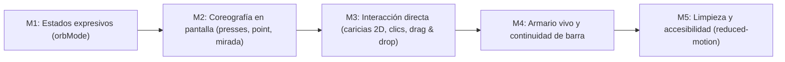

# Plan de implementación — Mejora de animaciones e interacciones de la mascota

> **Propósito:** Plan autocontenido para mejorar las animaciones, expresiones e interacciones de la mascota en `src/app/features/assistant/`.
> **Regla por fase:** Cada fase debe dejar en verde `npm run build`, `npm run lint` y `npx ng test --watch=false --include="src/app/features/assistant/**/*.spec.ts"`.
> **Restricción de arquitectura:** Mantener Angular v20+ standalone con `ChangeDetectionStrategy.OnPush`, signals, funciones geométricas/coreográficas puras separadas del DOM (para tests unitarios rápidos sin montar navegador pesado) y respeto estricto a `prefers-reduced-motion: reduce`.

---

## 0. Contexto y brechas detectadas en el código actual

| # | Brecha detectada | Ubicación exacta | Impacto actual |
|---|---|---|---|
| **B1** | **8 de los 12 modos de `MascotMode` nunca se activan** | `src/app/features/assistant/mascot-state.service.ts` (L198–203) vs `src/app/features/assistant/components/mascot-orb.ts` (L258–285) | `MascotOrb.eyesOf()` soporta 12 modos (`idle`, `listening`, `thinking`, `acting`, `confirm`, `paused`, `done`, `reading`, `wardrobe`, `happy`, `confused`, `sleeping`), pero `orbMode()` solo devuelve 4 (`thinking`, `confirm`, `listening`, `idle`). |
| **B2** | **`sending()` eclipsa a `paused`, `confirm` y `acting`** | `src/app/features/assistant/mascot-state.service.ts` (L198–203) y `src/app/features/assistant/mascot/mascot-life.service.ts` (L182) | Como `if (this.sending()) return 'thinking'` va primero, durante un turno en streaming la mascota nunca pasa a `paused` (cuando `cursor.paused()` es `true`), ni a `confirm` (cuando espera respuesta en `questions.current()` o `pendingAction()`), ni a `acting` (mientras rellena campos o ejecuta tools). Además, como `MascotLifeService` comprueba `mode === 'confirm'` para sacar el móvil tras `PHONE_AFTER_MS` (20 s), **nunca saca el móvil esperando una pregunta en vivo**. |
| **B3** | **`fill.presses` se incrementa en 5 sitios pero nadie lo pinta** | `src/app/features/assistant/mascot/fill/mascot-fill.service.ts` (L37–38), `src/app/features/assistant/mascot/fill/animated-fill.ts` (L236, L252, L316, L341), `src/app/features/assistant/copilot/tools/press.run.ts` (L81) | `presses = signal(0)` dice *"Sube en cada pulsación, para que el anillo se repita aunque sean dos seguidas"*, pero ningún componente lo consume. No hay feedback visual de toque cuando la mascota pulsa botones o enfoca campos. |
| **B4** | **`point_at` y `show_around` no resaltan el control señalado** | `src/app/features/assistant/copilot/tools/point.run.ts` (L28–36), `src/app/features/assistant/copilot/tools/tour.run.ts` (L58–65) | `playHighlight` aplica `data-mascot-highlight` (`HIGHLIGHT_ATTR`), pero `runPointAt` y `runShowAround` solo viajan hasta el control sin encender el latido `[data-mascot-highlight]`. |
| **B5** | **Mirada fija e impersonal al rellenar/señalar campos y corte de `.mascot-doing`** | `src/app/features/assistant/mascot/placement.ts` (L71–88), `src/app/features/assistant/components/mascot-launcher.ts` (L46–57, L167–181) | La mascota se coloca a la izquierda o derecha del campo (`orbBeside`), pero sus pupilas no miran hacia el control objetivo y el bocadillo `.mascot-doing` (`bottom: 94px`) se sale por arriba del viewport si el campo está cerca del borde superior (`top < 90px`). |
| **B6** | **Interacciones directas con el orbe limitadas o bloqueadas** | `src/app/features/assistant/mascot/lifeDetectors.ts` (L43–81), `src/app/features/assistant/components/mascot-launcher.ts` (L297–299) | 1) `PettingDetector` solo mide `clientX` (ignora caricias verticales/diagonales). 2) Con la barra abierta, hacer clic en la mascota acoplada no da ningún feedback hasta el 5.º clic (`CLICK_BURST`). 3) `.mascot-fab--catching { transform: scale(1.12); }` es pisado por `[style.transform]="fabTransform()"` inline y solo se activa sobre los 62 px del botón. |
| **B7** | **El orbe del escenario en `MascotWardrobe` está dormido e inerte** | `src/app/features/assistant/components/mascot-wardrobe.ts` (L58) | Usa `[decorative]="true"` y `mode="idle"`, por lo que tiene los ojos cerrados (`SHUT`), no parpadea y al elegir una fruta en el estante no enseña su personalidad (`PERSONALITIES`). |
| **B8** | **Cortes secos al cerrar `MascotBar` y CSS duplicado** | `src/app/features/assistant/bar/mascot-bar.html` (L1), `src/app/features/assistant/components/mascot-launcher.ts` (L238–250 y L354–366) | La barra se desenrolla en 500 ms al abrir, pero desaparece en 0 ms al cerrar mientras el FAB viaja 500 ms solo hacia la esquina. Además, `.mascot-cape` está duplicado en `mascot-launcher.ts`. |

---

## Mapa de fases

---

## Fase M1 — Conectar todos los estados expresivos (`MascotMode`)

**Objetivo:** Que `MascotStateService.orbMode()` refleje con precisión qué está haciendo la mascota en cada momento del turno y desbloquee los temporizadores de espera de `MascotLifeService`.

| # | Tarea | Ficheros | Especificación detallada |
|---|---|---|---|
| **M1.1** | **Jerarquía completa en `orbMode()`** | `src/app/features/assistant/mascot-state.service.ts` (L198–203) | Actualizar `orbMode = computed<MascotMode>(...)` con este orden estricto de prioridad: 1. `if (this.wardrobeOpen()) return 'wardrobe';` 2. `if (this.cursor.paused()) return 'paused';` 3. `if (this.pendingAction() !== null || this.questions.current() !== null) return 'confirm';` 4. `if (this.uploading()) return 'reading';` 5. `if (this.fill.filling() || this.runner.running() !== null) return 'acting';` 6. `if (this.sending()) return 'thinking';` 7. `if (this.transientMode()) return this.transientMode()!;` *(ver M1.2)* 8. `if (this.open()) return 'listening';` 9. `return 'idle';` |
| **M1.2** | **Estados transitorios `done` y `confused` tras rellenar** | `src/app/features/assistant/mascot/fill/mascot-fill.service.ts`, `src/app/features/assistant/mascot/fill/animated-fill.ts`, `src/app/features/assistant/mascot-state.service.ts` | Añadir un estado transitorio breve al finalizar `playFill`: - Cuando termina con `rejected.length > 0` o `(missing.length > 0 && written.length === 0)`, activar `'confused'` durante `1600 ms`. - Cuando termina con `written.length > 0 && rejected.length === 0`, activar `'done'` durante `1400 ms`. |
| **M1.3** | **Despertar atención al hacer preguntas** | `src/app/features/assistant/copilot/question.service.ts` (L67–83) | Al pasar `orbMode()` a `'confirm'` durante `questions.current()`, `MascotLifeService` ya activará automáticamente `waiting = mode === 'confirm'` y sacará el teléfono tras `PHONE_AFTER_MS` (20 s). Asegurar que cuando el usuario responde (`answer()` / `decline()`), `MascotLifeService` limpia el teléfono inmediatamente al cambiar `mode`. |

**Tests requeridos (M1):**
- Ampliar `src/app/features/assistant/mascot-state.service.spec.ts`:
  - Verificar que con `sending() === true` y `cursor.paused() === true`, `orbMode()` es `'paused'`.
  - Verificar que con `sending() === true` y `questions.current() !== null` (o `pendingAction() !== null`), `orbMode()` es `'confirm'`.
  - Verificar que con `sending() === true` y `fill.filling() === true`, `orbMode()` es `'acting'`.
  - Verificar que con `uploading() === true`, `orbMode()` es `'reading'`.
- En `src/app/features/assistant/mascot/mascot-life.service.spec.ts`: comprobar que en modo `'confirm'` tras `PHONE_AFTER_MS` `life()` emite `{ kind: 'phone', glance: false }`.

---

## Fase M2 — Coreografía en pantalla: anillo de pulsación, resaltado y dirección de mirada

**Objetivo:** Conectar la señal huérfana `fill.presses()`, resaltar los controles señalados en `point_at` / `show_around`, orientar la mirada hacia el control activo y evitar que el bocadillo `.mascot-doing` se corte en el borde superior.

| # | Tarea | Ficheros | Especificación detallada |
|---|---|---|---|
| **M2.1** | **Anillo e impulso físico al pulsar (`fill.presses`)** | `src/app/features/assistant/components/mascot-launcher.ts` | Consumir `fill.presses()` en `MascotLauncher`: - Cuando `fill.presses()` incrementa (`> 0`), renderizar/reiniciar un `` dentro de `.mascot-fab` que se expande de `scale(0.8)` a `scale(1.65)` con `opacity: 0.7 -> 0` en `380 ms ease-out` (borde de `2px solid var(--primary)`). - Usar el valor de `fill.presses()` para que dos pulsaciones seguidas repitan el anillo fielmente. - Con `prefers-reduced-motion: reduce`, no animar escala (`animation: none`). |
| **M2.2** | **Resaltado `data-mascot-highlight` en `point_at` y `show_around`** | `src/app/features/assistant/copilot/tools/point.run.ts` (L28–36), `src/app/features/assistant/copilot/tools/tour.run.ts` (L58–65) | En `runPointAt` y en cada parada de `runShowAround`, una vez que `goToElement(found.element, ...)` devuelve `true`: - Aplicar `found.element.setAttribute(HIGHLIGHT_ATTR, '')` dentro de `try { await fill.wait(...); } finally { found.element.removeAttribute(HIGHLIGHT_ATTR); }`, igual que en `playHighlight` (`animated-fill.ts` L476–481). |
| **M2.3** | **Orientar la mirada hacia el campo o control objetivo** | `src/app/features/assistant/mascot/placement.ts` (L38–88), `src/app/features/assistant/components/mascot-orb.ts` (L266–267), `src/app/features/assistant/components/mascot-launcher.ts` | 1. En `placement.ts`, añadir una función pura `lookSide(spot: Spot, field: Box): -1 | 1` que devuelva `1` si el centro del campo está a la derecha del centro del orbe y `-1` si está a su izquierda. 2. Añadir un input opcional `lookX = input<-1 | 0 | 1>(0)` en `MascotOrb`. 3. En `MascotOrb.eyesOf('acting')`, usar `pair(bar(1, this.lookX() * 2.5, 0))` en lugar de `pair(bar(1))` para que la mascota mire hacia el campo que está escribiendo o señalando. |
| **M2.4** | **Reposicionar `.mascot-doing` cerca del techo del viewport** | `src/app/features/assistant/components/mascot-launcher.ts` (L115–120, L167–181) | En `MascotLauncher`, calcular una señal `doingBelow = computed(...)` que sea `true` cuando el destino del viaje deje el orbe a menos de `88 px` del borde superior de la ventana (`spot.top < 88`). Añadir `[class.mascot-doing--below]="doingBelow()"` para que cuando esté cerca del techo el bocadillo se pinte justo debajo del orbe y nunca quede recortado fuera de la ventana. |

**Tests requeridos (M2):**
- `src/app/features/assistant/copilot/tools/point.run.spec.ts` y `tour.run.spec.ts`: verificar que `found.element.hasAttribute('data-mascot-highlight')` es `true` durante la espera y se limpia en `finally` (incluso si se aborta la señal).
- `src/app/features/assistant/mascot/placement.spec.ts`: probar `lookSide` (`1` cuando la mascota se coloca a la izquierda del campo, `-1` cuando se coloca a la derecha).
- `src/app/features/assistant/components/mascot-launcher.spec.ts`: verificar que al incrementar `fill.presses()` se renderiza `.mascot-press-ring`.

---

## Fase M3 — Interacciones directas con el orbe (caricias 2D, toque acoplado y Drag & Drop)

**Objetivo:** Hacer que las interacciones físicas con el cursor o archivos sobre la mascota respondan de forma natural en cualquier dirección y estado.

| # | Tarea | Ficheros | Especificación detallada |
|---|---|---|---|
| **M3.1** | **`PettingDetector` en 2D** | `src/app/features/assistant/mascot/lifeDetectors.ts` (L36–82), `src/app/features/assistant/mascot/mascot-life.service.ts` (L260–266), `src/app/features/assistant/components/mascot-orb.ts` (L212–215) | Ampliar `PettingDetector.move(x: number, now: number, y?: number): boolean` (manteniendo `y = 0` por defecto para retrocompatibilidad con tests existentes): - Calcular el vector `(dx, dy)` respecto al `anchor: { x, y }`. - Si la distancia recorrida `Math.hypot(dx, dy) >= config.minTravel`, comprobar el producto escalar `dx * prevDx + dy * prevDy < 0` para detectar una reversión de dirección en cualquier ángulo (horizontal, vertical o diagonal). - Pasar `event.clientX, event.clientY` desde `MascotOrb.onMove()`. |
| **M3.2** | **Micro-reacción al pulsar la mascota cuando la barra ya está abierta** | `src/app/features/assistant/mascot-state.service.ts` (L327–330) | Hoy, cuando `state.open()` es `true`, `state.toggle()` hace `return` sin hacer nada, por lo que los primeros 4 clics parecen muertos hasta que el 5.º dispara `dizzy`. - En `MascotStateService.toggle()`: si `this.open()` ya es `true`, llamar a `this.mood.feel('highfive', 700)` para que tocarla con el panel abierto dé respuesta inmediata, sin impedir que 5 clics rápidos sigan activando `dizzy` en `MascotOrb.onClick()`. |
| **M3.3** | **Arreglar el escalado de `catching` y anticipar el Drag & Drop** | `src/app/features/assistant/components/mascot-launcher.ts` (L127–132, L297–299) | 1. En `MascotLauncher`, `.mascot-fab--catching { transform: scale(1.12); }` es ignorado cuando `[style.transform]="fabTransform()"` aplica un transform inline (por ejemplo, cuando está acoplada o en pose). Mover el escalado a `.mascot-fab--catching app-mascot-orb { transform: scale(1.14); transition: transform 180ms cubic-bezier(0.2, 0.8, 0.3, 1); }` para que nunca colisione con `fabTransform()`. 2. Escuchar `dragenter`/`dragleave`/`drop` de archivos (`dataTransfer?.types?.includes('Files')`) a nivel de `document` en `MascotLauncher` (limpiado con `DestroyRef`): mientras el usuario arrastra un archivo por la ventana, despertar a la mascota (`life.attend()`) y mostrar una clase `.mascot-fab--file-near` con un realce sutil que invite a soltarle el archivo encima. |

**Tests requeridos (M3):**
- `src/app/features/assistant/mascot/lifeDetectors.spec.ts`: mantener los tests horizontales existentes y añadir tests para caricias verticales (`x` fijo, `y` alternando) y diagonales.
- `src/app/features/assistant/components/mascot-launcher.spec.ts`: comprobar que arrastrar un archivo aplica `.mascot-fab--catching` sin perder `fabTransform()`.

---

## Fase M4 — Armario vivo (`MascotWardrobe`) y continuidad en `MascotBar`

**Objetivo:** Que el probador del armario muestre a la mascota viva y enseñe el carácter de cada fruta al probarla, y que la barra inferior suavice la aparición de sus bloques internos.

| # | Tarea | Ficheros | Especificación detallada |
|---|---|---|---|
| **M4.1** | **Despertar el modelo del escenario en `MascotWardrobe` y previsualizar su personalidad** | `src/app/features/assistant/components/mascot-wardrobe.ts` (L57–59), `src/app/features/assistant/components/mascot-orb.ts` | 1. En `MascotOrb`, añadir un input opcional `previewScene = input<Scene | null>(null)` que tenga prioridad en `scene()` y `eyes()` incluso cuando `[decorative]="true"`, sin alterar el singleton `MascotLifeService`. 2. En `MascotWardrobe`, pasar `[mode]="'wardrobe'"` al `<app-mascot-orb>` grande del escenario (`.wd-model`) para que tenga los ojos abiertos (`bar(1, 0, 1)`) y parpadee (`blink = 1`) en lugar de estar dormido (`SHUT`). 3. En `MascotWardrobe`, cada vez que el usuario selecciona una fruta distinta en el estante o con las flechas (`pick.set(...)`), activar `previewScene.set('blush')` durante `1800 ms` en el orbe del escenario. Así cada fruta ejecuta su `happyMove` (`sway`, `hop`, `preen`, `still`) y sus `happyBits` (`heart`, `star`, `both`, `none`) definidos en `personalities.ts`. |
| **M4.2** | **Entrada suave de bloques internos en `MascotBar`** | `src/app/features/assistant/bar/mascot-bar.scss` (L59–160) | Añadir en `mascot-bar.scss` una micro-animación de entrada (`160 ms var(--motion-ease-out)`) para los bloques dinámicos dentro de `.card__body` (`.say`, `.doing`, `.consent`, `.first`, `app-mascot-action-card`) para suavizar el cambio cuando la tarjeta pasa de pastilla (`.card--pill`) a mostrar contenido, desactivándola bajo `@media (prefers-reduced-motion: reduce)`. |

**Tests requeridos (M4):**
- `src/app/features/assistant/components/mascot-wardrobe.spec.ts`: verificar que el orbe del escenario recibe `mode="wardrobe"` y que al cambiar de skin se activa `previewScene="blush"` temporalmente y se limpia tras el timeout.

---

## Fase M5 — Limpieza técnica y accesibilidad (`prefers-reduced-motion`)

**Objetivo:** Eliminar duplicidades CSS y garantizar que todas las mejoras nuevas respetan `prefers-reduced-motion: reduce`.

| # | Tarea | Ficheros | Especificación detallada |
|---|---|---|---|
| **M5.1** | **Eliminar CSS duplicado en `MascotLauncher`** | `src/app/features/assistant/components/mascot-launcher.ts` (L353–366) | Eliminar el bloque `.mascot-cape` duplicado dentro de `@media (max-width: 640px)` (líneas 353–366), que es idéntico al de las líneas 237–250. |
| **M5.2** | **Auditoría `prefers-reduced-motion` y verificación final** | `src/app/features/assistant/components/mascot-launcher.ts`, `src/app/features/assistant/bar/mascot-bar.scss`, `src/app/features/assistant/components/mascot-orb.ts` | Verificar que bajo `@media (prefers-reduced-motion: reduce)`: - `.mascot-press-ring` y `.mascot-fab--catching app-mascot-orb` no escalan espacialmente. - Las animaciones de `.card__body` tienen `animation: none`. - `MascotOrb` con `previewScene` en el armario aplica la pose estática (`!m.on` en `agentMotion.ts`) sin bucles infinitos. - Ejecutar `npm run build`, `npm run lint` y `npx ng test --watch=false --include="src/app/features/assistant/**/*.spec.ts"`. |
