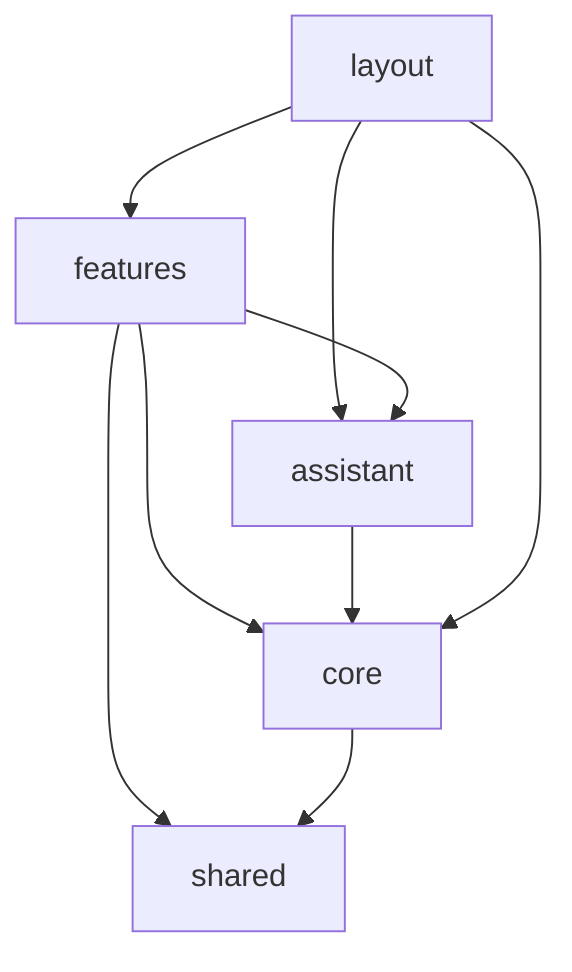

# sif-web architecture

An Angular 21 standalone SPA in front of an external Spring Boot REST API (not in this repo; its
feature contracts live in `doc/`). Keycloak handles identity. The SPA holds no business rules the
backend doesn't also enforce: tenant isolation and permissions are checked server-side, and the
frontend only mirrors them to shape the UI.

## Topology

- **`core`** (`src/app/core/`): cross-cutting services. These are auth/tenant context, permissions,
  typed API clients + SSE streams, HTTP interceptors, runtime config, i18n, branding, and the UI
  service wrappers. See `core-module`.
- **`features`** (`src/app/features/<domain>/`): one folder per business area. Each holds
  lazy-loaded pages and their dialogs. See `features-module`.
- **`assistant`** (`src/app/features/assistant/`): the conversational assistant ("mascota"). It lives
  under `features/`, but it is a cross-cutting layer that other features plug into. See
  `assistant-module`.
- **`layout`** (`src/app/layout/`): the authenticated `Shell` (permission-filtered nav, tenant
  switcher, theme toggle, notifications bell, lazy assistant launcher).
- **`shared`** (`src/app/shared/`): presentational UI pieces (page header, empty state,
  pagination, tenant logo…), pure utils and pipes. No feature or API knowledge.

## Decisions

- **Standalone + lazy routes.** Everything is standalone (no NgModules). `app.routes.ts` lazy-loads
  each page with `loadComponent`. Pages are `*.page.ts` with a **default export**, and the route
  imports depend on it.
- **Signals for state.** State is `signal`/`computed`/`effect` in injectable services. There is no
  store library, and no new `BehaviorSubject` state is added.
- **Tenant context comes from the user, not the URL.** `GET /users/me` returns the memberships, and
  the active tenant is picked from `localStorage['active-tenant']` or falls back to the first
  membership. `TenantContextService` derives the tenant id, membership and permission set. Switching
  tenant reloads the whole page, so no per-tenant state has to be reset by hand.
- **Runtime config, not build config.** URLs and Keycloak settings come from `window.ENV`. The Docker
  entrypoint `sed`-replaces placeholders in `index.html`, so a single bundle serves every environment
  (nginx, SPA fallback).
- **One HTTP pipeline.** `authInterceptor` → `errorInterceptor` → `loadingInterceptor` →
  `mascotWritesInterceptor`. Errors are mapped once, globally (401 refresh, 403 redirect, 404
  warning unless `IGNORE_NOT_FOUND`, otherwise a toast). Pages don't re-toast HTTP errors.
- **Taiga UI for every control, Tailwind for layout only.** Visual tokens live in `src/styles.less`
  and follow `design-guide`. Multi-tenant brand theming (`--brand-primary`) follows `design-tokens`.
- **i18n with Transloco** (`es` default, `en`). Taiga's own language is kept in sync with it.
- **Skeletons via boneyard.** These are captured from the real pages (via the unauthenticated
  `sandbox` route, which production replaces with an empty route file). `src/bones/registry.ts` is
  generated and never edited by hand.

## Invariants

- `core` and `shared` never import from `features/`. The only `layout` → feature reach is the lazy
  `import()` of the assistant launcher.
- Every API call is tenant-scoped through `TenantContextService.currentTenantId()`. Clients never
  take a tenant id from the URL or from user input.
- Every mutation in the UI is gated by a permission code (`*appIfPermission` /
  `PermissionsService.has`). Nav items and guarded routes use the same codes.
- Paginated responses use the Spring `PagedModel` shape (`{ content, page: {…} }`).

## Known limitations

- "My Patients" (`/my-patients`) is hidden for every role (route and nav item commented out, marked
  `TODO(V45)`) until the feature is finished.
