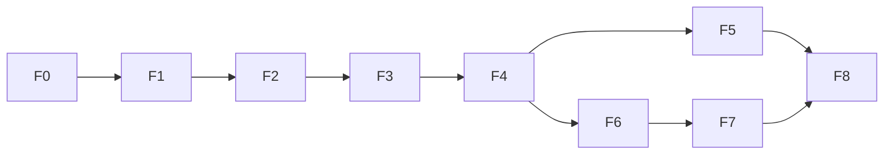

# Plan de implementación — Copiloto de la mascota (frontend)

> **Qué es:** el desglose ejecutable de [`plan-copiloto-alkimia.md`](plan-copiloto-alkimia.md), con tareas, ficheros, tests y criterio de «hecho».
> **Contrato vigente:** `tus-dietas/doc/assistant/assistant-frontend.md` §3.2 y `mascota-frontend.md` §1.1. Las fases B0–B3 están implementadas en `develop`, commit `b2f7b1a`. El resumen está en el §6 del plan de adaptación.
> **Regla para cada fase:** se entrega en su propia rama/PR con `npm run build`, `npm run lint` y `npm test -- --include=src/app/features/assistant/**` en verde. El modelo antiguo (`uiActions` + `pendingAction` por el endpoint bloqueante) **sigue funcionando hasta la fase 7**.
> **Fecha:** 2026-11-07

---

## 0. Mapa de fases

| Fase | Entrega | Est. | Depende de |
|---|---|---|---|
| **F0** | Sincronizar contratos y specs | 0,5 d | — |
| **F1** | Transporte: `client_tool`, `tool-results`, detener, turno colgado | 4 d | F0 |
| **F2** | Registro de herramientas, catálogo, `pageContext`, límite de pasos | 4 d | F1 |
| **F3** | Formularios con resultado: `fill_`, `open_`, `navigate`, `edit_` | 8 d | F2 |
| **F4** | `confirm_action`, `ask_user`, `point_at`, `show_around`, `press`, `action_` | 8 d | F3 |
| **F5** | `save_` y la cabecera `X-Assistant-Write` | 5 d | F4 |
| **F6** | Barra inferior (sustituye al panel) | 12 d | F4; en paralelo a F5 |
| **F7** | Vida y encanto | 8 d | F6 |
| **F8** | Retirada del modelo antiguo (y la B4 en el backend) | 2 d | F3–F7 |
| | | **≈ 51 d (≈ 10–11 sem)** | |



### Estructura de carpetas objetivo

```
src/app/features/assistant/
  copilot/                        ← NUEVO: el bucle de herramientas
    client-tool.model.ts          tipos ClientTool, ToolResult, ToolRun, reasons
    tool-registry.service.ts      catálogo + despacho
    tool-runner.service.ts        ejecuta client_tool → POST tool-results
    tool-names.ts                 id de surface → nombre válido (sin guiones)
    page-context.ts               construye pageContext con presupuesto
    step-limiter.ts               30 pasos por petición
    schema.ts                     FillSurface → JSON Schema (≤ 2 KB)
    cursor.service.ts             pausar / reanudar
    assistant-write.interceptor.ts  X-Assistant-Write
    tools/
      echo.run.ts  fill.run.ts  edit.run.ts  open.run.ts  navigate.run.ts
      point.run.ts tour.run.ts  ask.run.ts   press.run.ts confirm-action.run.ts
      save.run.ts  action.run.ts
    text-edit.ts                  port puro de alkimia textEdit.ts
    pointing.ts                   data-mascot-point, resolvePointable, isDangerous
  bar/                            ← NUEVO en F6
  components/  mascot/  (existentes)
```

---

## F0 — Sincronizar contratos y specs (0,5 d)

**Por qué primero:** las copias de sif-web (`doc/assistant-frontend.md` → `assistant-contract`, `doc/mascota-frontend.md` → `mascota-contract`) están 100 líneas por detrás de las de `tus-dietas`.

| # | Tarea | Ficheros |
|---|---|---|
| 0.1 | Copiar el §3.2 (herramientas de cliente) y el §1.1 (regla de oro) desde `tus-dietas/doc/assistant/` **conservando el frontmatter** de sif-web (`id`, `parent: assistant-module`). | `doc/assistant-frontend.md`, `doc/mascota-frontend.md` |
| 0.2 | Actualizar la regla de producto: «la mascota puede pulsar Guardar tras un sí explícito; nunca escribe en el backend por sí misma». | `PRODUCT.md` §Assistant, `src/app/features/assistant/SPEC.md` |
| 0.3 | Recoger en `assistant-module` la boundary nueva: `copilot/` depende de `MascotFillService` y de los atributos `data-mascot-*`, y nunca importa pantallas. | `SPEC.md` |
| 0.4 | `spec_validate` en verde. | — |

**Hecho cuando:** los contratos de los dos repos dicen lo mismo y los specs reflejan la nueva regla.

---

## F1 — Transporte (4 d)

Objetivo: que un `client_tool` vaya y vuelva. Se prueba con la herramienta `echo`.

| # | Tarea | Ficheros | Detalle |
|---|---|---|---|
| 1.1 | Eventos nuevos en el parser SSE | `core/api/services/assistant-stream.ts`, `core/api/models/assistant.model.ts` | Hay que ampliar `AssistantStreamEvent`:<br>- `{ kind:'client_tool', runId, callId, name, args }`.<br>- `{ kind:'stopped', runId }`.<br>- `ping`: el parser debe devolver `null` (hoy ya lo hace, porque `ping` no tiene `case`; hace falta un test que lo fije). |
| 1.2 | Cuerpo del stream ampliado | `assistant.api.ts` `streamMessage` | Pasa a recibir un objeto `{ content, attachmentId?, clientTools?, pageContext? }` en lugar de argumentos sueltos. Así se evita una lista de parámetros posicionales que no para de crecer. |
| 1.3 | `postToolResult(tenantId, runId, callId, result)` | `assistant.api.ts` | `202` y `204` son éxito, `404` significa que el run ya no existe. Debe llevar el contexto `silent`, para que el `errorInterceptor` no muestre toasts. |
| 1.4 | `stopRun(tenantId, runId)` | `assistant.api.ts` | `DELETE /runs/{runId}`, también `silent`. |
| 1.5 | `pendingRunId` en la sesión | `AssistantSessionDto` | Es opcional. |
| 1.6 | `ToolRunnerService` | `copilot/tool-runner.service.ts` | Recibe un `client_tool`, busca su `run` en el registro (F2; en F1 solo existe `echo`), lo ejecuta con un `try/catch` y hace `postToolResult`.<br>- Si la herramienta no se conoce: `{ ok:false, reason:'unknown_tool' }`.<br>- Si la ejecución lanza una excepción: `{ ok:false, reason:'tool_error', message }`.<br>- Si el `POST` devuelve `404`: se aborta el turno localmente.<br>- Solo hay una llamada en curso a la vez (el backend no envía dos). |
| 1.7 | Integración en `streamTurn` | `mascot-state.service.ts` | El caso `client_tool` guarda `runId` en un signal `activeRunId` y delega en el runner. El caso `stopped` se trata como el `stop()` local. **No** se cancela la suscripción SSE mientras se espera, porque el stream sigue vivo. |
| 1.8 | `stop()` con el backend | `mascot-state.service.ts` | Si hay `activeRunId`, se hace `stopRun` y **se espera al evento `stopped`** (con 3 s de tope). Si no hay `runId`, se sigue haciendo lo de hoy: cerrar el SSE. En ambos casos lo ya escrito se queda marcado como detenido. |
| 1.9 | Turno colgado | `mascot-state.service.ts` `ensureSession` / `openPanel` | Si la sesión trae `pendingRunId`, se llama a `stopRun` antes de permitir el primer `send` (`send` lo espera). |
| 1.10 | Contexto de la ejecución | `tool-runner.service.ts` | Es un signal `runningTool: { name, callId } \| null`. Lo leen la UI («Paso n») y el interceptor de F5. |

**Tests**
- `assistant-stream.spec.ts`: `client_tool`, `stopped`, y `ping` ignorado.
- `tool-runner.spec.ts`: herramienta desconocida, ejecución que lanza, `404`, y `echo` devolviendo sus `args`.
- `mascot-state.client-tool.spec.ts`: un stream con `delta` → `client_tool echo` → `POST` → `delta` → `done`.
- `stop` con `runId`: hace `DELETE` y se cierra al recibir `stopped`.
- `pendingRunId` en la sesión: se hace `DELETE` antes del `POST /messages/stream`.

**Hecho cuando:** contra el backend real, «llama a echo con hola» hace que el modelo responda con el resultado.

---

## F2 — Registro, catálogo, contexto y límite (4 d)

| # | Tarea | Ficheros | Detalle |
|---|---|---|---|
| 2.1 | Tipos | `copilot/client-tool.model.ts` | `ClientToolDecl { name, description, parameters }`.<br>`ToolRun = (args) => Promise<ToolResult>`.<br>`ToolResult = { ok:boolean; reason?:string; [k:string]:unknown }`.<br>Enum de razones: `unknown_tool`, `tool_error`, `surface_gone`, `user_declined`, `control_gone`, `control_disabled`, `step_budget_exhausted_local`. |
| 2.2 | Nombres válidos | `copilot/tool-names.ts` | `toolName(prefix, id)` convierte `-` en `_`, valida `^[a-z][a-z0-9_]{2,48}$` y, si no cumple, devuelve `null` y lanza un `console.warn` en desarrollo. `idFromTool(name)` hace la conversión inversa usando el registro, no la cadena. |
| 2.3 | Esquema desde el descriptor | `copilot/schema.ts` | `toJsonSchema(surface)` convierte cada `FillKind` a un tipo JSON:<br>- `text`, `date` y `time` → `string` (con un `description` de formato).<br>- `number` → `number`.<br>- `boolean` → `boolean`.<br>- `choice` → `string` con `enum` (hay que añadir `options?` a `FillField`).<br>- Las listas → `array` de `object`.<br>Las descripciones de campo salen de i18n (`assistant.fields.<surface>.<key>`) y se recortan.<br>**Si el resultado pasa de 2 KB:** primero se quitan las descripciones de campo, después se parte en `fill_<id>` + `fill_<id>_<grupo>`, con un grupo por `reveal` (por ejemplo, `measurement` por pasos). Un test lo fija para las 15 surfaces. |
| 2.4 | `ToolRegistryService` | `copilot/tool-registry.service.ts` | Es un `computed` sobre las surfaces y openers registrados en `MascotFillService` más las herramientas globales (`navigate`, `ask_user`, `point_at`, `show_around`, `press`). Expone:<br>- `catalog(): ClientToolDecl[]`, con un máximo de 40 y prioridad por orden: globales, después las surfaces montadas y por último los openers.<br>- `runFor(name)`.<br>Se valida en el cliente con **las mismas reglas que `ClientToolValidator`**, para que nada se descarte en silencio sin aviso en desarrollo. |
| 2.5 | `pageContext` | `copilot/page-context.ts` | `buildPageContext({ route, title, forms, extras })`. `forms[].id` es el **mismo id normalizado** que la herramienta y `values` sale de `FieldAccess.get`. Presupuesto de 22 000 caracteres: primero se recortan los extras, después los forms, y cada valor tiene un tope de 4 000. Es una función pura.<br>El título sale de `Title`. Los extras los aporta cada pantalla con `MascotFillService.provideExtras(key, () => …)`. Al principio solo `appointments` (día seleccionado) y `users/:id` (paciente activo). |
| 2.6 | Límite de pasos | `copilot/step-limiter.ts` | Como mucho 30 por mensaje y se reinicia con cada `send`. Al pasarlo, el runner responde `{ ok:false, reason:'step_budget_exhausted_local' }` sin ejecutar nada. Es una red de seguridad junto a la del backend. |
| 2.7 | Enviar el catálogo y el contexto | `mascot-state.service.ts` `streamTurn` | En cada envío van `clientTools: registry.catalog()` y `pageContext: buildPageContext(...)`. |
| 2.8 | Panel de depuración (solo en desarrollo) | `components/mascot-panel` | Un `<details>` con el catálogo enviado, su tamaño y lo descartado. Va detrás de `!environment.production`. |

**Tests**
- `tool-names.spec.ts`.
- `schema.spec.ts`: las 15 surfaces quedan en 2 KB o menos y el esquema es válido.
- `page-context.spec.ts`: orden de recorte, tope por valor y flag de recorte.
- `tool-registry.spec.ts`: tope de 40, nombres duplicados y colisión con nombres de servidor.
- `step-limiter.spec.ts`.

**Hecho cuando:** con la ficha de paciente abierta, el catálogo enviado contiene `fill_patient_profile` y el `pageContext` trae sus valores. Se comprueba en la pestaña de red.

---

## F3 — Formularios con resultado (8 d)

| # | Tarea | Ficheros | Detalle |
|---|---|---|---|
| 3.1 | `fill_<id>` | `copilot/tools/fill.run.ts`, `mascot/fill/animated-fill.ts` | Vuelve a leer la surface montada en el momento de la llamada. Si ya no está, responde `surface_gone`. Espera a `ready()` con un tope de 3 s.<br>Reutiliza `playFill`, ampliando `FillReport` con:<br>- `rejected: { field, reason }[]`: valor no parseable, opción inexistente, o control que tras escribir no tiene ese valor.<br>- `missing_required`: lee los `Validators.required` del `FormGroup`.<br>Responde `{ ok, written, rejected, missing_required }`. |
| 3.2 | Marca de «escrito por la mascota» | `animated-fill.ts`, `styles.less` | Añade `data-mascot-written` en el campo hasta que la persona lo edite (`input` de usuario). Usa el estilo de token `--mascot-written` (un subrayado verde suave). |
| 3.3 | `open_<id>` | `copilot/tools/open.run.ts` | Usa `FillOpener` (ya existe) y espera a que se registre la surface (`waitForTool`, 3 s). Responde `{ ok, opened: id, clientTools }`: incluye el catálogo nuevo, igual que `navigate`. |
| 3.4 | `navigate` | `copilot/tools/navigate.run.ts`, `surfaces/routes.ts` | Parámetros: `{ screen: enum, params }`. La lista blanca es la de `routeFor` actual, **pasada a un `enum` en el esquema**. Espera entre 250 ms y 2 s a que la ruta cambie y se registren surfaces.<br>Responde `{ ok, route, clientTools }` con el catálogo de la pantalla nueva. Cierra el panel o la barra si tapan la pantalla, como hoy. |
| 3.5 | `edit_<id>` | `copilot/text-edit.ts` (port de alkimia), `copilot/tools/edit.run.ts` | Solo se genera para surfaces con campos de texto largo, marcados con `long: true` en `FillField`: notas de cita, observaciones, anamnesis y descripción de plantilla.<br>Operaciones: `append`, `prepend`, `insert_after`, `insert_before`, `replace` y `delete`. Si el fragmento no aparece o aparece dos veces, responde `not_found` o `ambiguous`. |
| 3.6 | Convivencia con `pendingAction` | `mascot-state.service.ts` `offerAction` | Cuando llega un `done` con `pendingAction` por el **endpoint de stream**, ya no se rellena automáticamente si la herramienta tiene `fill_` en el catálogo: el backend ahora prefiere el `fill_`. Se mantiene la ruta antigua para el endpoint bloqueante. |
| 3.7 | Ids de surface | `mascot/fill/surfaces/*.surface.ts` | No se renombran: la normalización está en `tool-names.ts`. Se añaden `options` a los `choice` y `long` donde corresponda. |
| 3.8 | Eventos de UI | `MascotFillService`, `mascot-launcher.ts` | Mientras se ejecuta una herramienta, el FAB está en modo `acting` y dice qué hace (`saying`, ya existe). |

**Tests**
- `fill.run.spec.ts`: surface desmontada, `rejected` en una opción inexistente y `missing_required`.
- `text-edit.spec.ts`: port de los tests de alkimia.
- `navigate.run.spec.ts`: devuelve el catálogo nuevo.
- `open.run.spec.ts`.
- `contract.spec.ts` (ya existe): se amplía para que toda surface genere herramientas válidas.

**Hecho cuando**, contra el backend real:
- «Apunta 72 kg y 95 de cintura a Ana» → navega a la ficha → abre la medición → la rellena → el modelo responde «hecho, falta guardar».
- «Cambia en las notas 'marzo' por 'abril'» usa `edit_` en lugar de reescribir el campo.

---

## F4 — Preguntar, confirmar, señalar y pulsar (8 d)

| # | Tarea | Ficheros | Detalle |
|---|---|---|---|
| 4.1 | `confirm_action` | `copilot/tools/confirm-action.run.ts`, `components/mascot-action-card.*` | No se declara. Al llegar, se pinta `mascot-action-card` con `args`, que tienen la forma de `AssistantPendingActionDto` y llevan `question`. Responde `{ confirmed }` al pulsar.<br>Si la persona confirma desde otra pestaña, el backend despierta el run. El `POST` local devolverá `204` y no pasa nada.<br>`resolvingAction` sigue funcionando. |
| 4.2 | Bandeja de preguntas común | `copilot/question.service.ts` | Un único sitio para lo que espera a la persona: `confirm_action`, `ask_user`, `press` y `save_`. Guarda `{ kind, question, options?, yesVerb?, danger?, resolve }` en un signal que pinta el panel (y la barra en F6). Solo hay una a la vez, y si llega otra, la anterior se resuelve como `superseded`. |
| 4.3 | `ask_user` | `copilot/tools/ask.run.ts` | `{ question, options[2..6] }`. Las opciones son cortas (hasta 40 caracteres) y la respuesta puede ser también texto libre desde la entrada. Responde `{ answer }` o `{ ok:false, reason:'user_declined' }`.<br>El orbe pasa a modo `waiting` (la «?» verde): hay que añadir ese modo a `MascotMode`. |
| 4.4 | Marcado del DOM | `copilot/pointing.ts`, plantillas de features | `data-mascot-point="<id>"` y `data-mascot-point-label` (i18n). `resolvePointable(id)` acepta un elemento con ese atributo o un campo de surface (`<surface>.<key>`). `isDangerous(el)` detecta `appearance="destructive"`, `data-mascot-danger` o los verbos borrar, eliminar, descartar y cancelar en la etiqueta. |
| 4.5 | Inventario de marcado (≈ 40 controles) | `appointments`, `users/user-detail`, `menus`, `templates`, `settings`, `shell` (nav) | Una lista cerrada en `copilot/POINTS.md`. Se marcan:<br>- Las entradas del menú lateral.<br>- Los botones «Nueva cita», «Nueva medición», «Generar menú», «Duplicar», «Marcar realizada» y «Cancelar cita».<br>- Las pestañas de la ficha.<br>- Los interruptores de recordatorios. |
| 4.6 | `point_at` | `copilot/tools/point.run.ts` | `{ target, say? }`. El orbe vuela con `agentMotion` (ya existe), muestra un halo durante 2,6 s y responde `{ ok }` o `control_gone`. |
| 4.7 | `show_around` | `copilot/tools/tour.run.ts` | `{ stops: [{ target, say }] }` con un máximo de 6 paradas de 2,6 s. Se puede pausar (F6) y saltar (`requestSkip`, ya existe). Responde `{ ok, shown: n }`. |
| 4.8 | `press` | `copilot/tools/press.run.ts` | `{ target, question, yesVerb }`. Pasos:<br>1. Señala el control.<br>2. Pregunta en la bandeja (si `isDangerous`, la tarjeta lo avisa en rojo).<br>3. Si la respuesta es sí, hace `el.click()`.<br>4. Vigila 500 ms: si aparece `[role=dialog]`/`alertdialog`/`tui-dialog`, responde `{ pressed:true, opened_dialog:true }` y **no lo atraviesa**.<br>Otras respuestas: `user_declined`, `control_gone` y `control_disabled`. |
| 4.9 | `action_<id>` | `MascotFillService.registerAction`, `copilot/tools/action.run.ts` | Cada pantalla declara `{ id, description, fields, confirm?, run }`. Si tiene `confirm`, pasa por la bandeja como `press`. Primeras acciones:<br>- `action_mark_appointment_done`.<br>- `action_duplicate_menu`.<br>- `action_toggle_reminders`. |

**Tests**
- `confirm-action.run.spec.ts`: sí, no, y la respuesta que llega desde la tarjeta.
- `question.service.spec.ts`: una pregunta reemplaza a otra.
- `press.run.spec.ts`: no pulsa sin un sí, no atraviesa un diálogo y avisa del peligro.
- `pointing.spec.ts`.
- `tour.run.spec.ts`.

**Hecho cuando:**
- «Crea una cita para Ana el martes a las 10» lleva a navegar, abrir y rellenar. Si falta el tipo, usa `ask_user`; tras la respuesta rellena el tipo y el modelo propone guardar.
- «Enséñame dónde se configuran los festivos» lanza un `show_around` de 3 paradas.

---

## F5 — Guardar con confirmación (5 d)

| # | Tarea | Ficheros | Detalle |
|---|---|---|---|
| 5.1 | Botón de guardar | `copilot/save-button.ts` | `data-mascot-submit="<surfaceId>"`: el botón puede estar fuera del formulario y admite varios ids separados por espacios. Si no está, se usa la heurística: `button[type=submit]` dentro del `form`, o el botón primario del `tui-dialog` que contiene la surface. Hay que marcar los 15 formularios explícitamente; la heurística queda solo como respaldo. |
| 5.2 | `save_<id>` | `copilot/tools/save.run.ts` | Pasos:<br>1. Señala el botón.<br>2. Pregunta en la bandeja, con un resumen de lo escrito (los `written` del último `fill_` de esa surface).<br>3. Si la respuesta es sí y el botón está habilitado, hace `click()`.<br>4. Vigila 4 s: si el diálogo o la surface se desmonta, responde `saved:true`. Si aparecen errores (`tui-error` visible o `form.invalid` con controles `touched`), responde `saved:false` con `errors[]` (nombres de campo). Si el botón queda `disabled` sin `aria-busy`, responde `saved:true`.<br>Otras respuestas: `user_declined`, `button_gone` y `button_disabled` (incluye `missing_required`). |
| 5.3 | Guardar por cuenta de la persona | `copilot/save-button.ts` `onPersonSave` | Mientras hay un `save_` en la bandeja, un clic de la persona en ese botón cuenta como «sí ya pulsado». Se vigila y se responde con `savedBy: 'person'`. |
| 5.4 | `aria-busy` en los botones de guardar | los 15 formularios | Se añade `[attr.aria-busy]="saving()"` donde no exista, para que la vigilancia distinga entre «guardando» y «guardado». |
| 5.5 | `X-Assistant-Write` | `copilot/assistant-write.interceptor.ts`, `app.config.ts` | Si `runner.runningTool()` es `fill_`, `edit_`, `save_`, `press` o `action_`, y la petición es `POST`/`PUT`/`PATCH`/`DELETE` y no va a `/assistant/`, se añade `X-Assistant-Write: <sessionId>`. Va antes de `mascotWritesInterceptor`. **Ventana:** desde el inicio de la herramienta hasta que responde, más 4 s de vigilancia en `save_`. |
| 5.6 | Specs | `PRODUCT.md`, `SPEC.md` | Confirmar que la nueva regla quedó escrita en F0. |

**Tests**
- `save.run.spec.ts`: no se pulsa sin un sí; botón deshabilitado; diálogo que se cierra → `saved`; error visible → `errors`; clic de la persona.
- `assistant-write.interceptor.spec.ts`: la cabecera solo va dentro de la ventana, solo en escrituras y nunca en las de `/assistant/`.

**Hecho cuando:** «Registra 72 kg a Ana y guárdalo» abre la medición, la rellena y pregunta «¿Lo guardo?». Tras el sí, guarda y el modelo confirma con `saved:true`. La petición lleva la cabecera.

---

## F6 — Barra inferior (12 d)

**Antes de programar:** un mockup HTML en `.thinkrail/context/mockups/mascot-bar.html`, con tres estados (reposo, trabajando con «Paso 3» y preguntando), y la aprobación de diseño. Debe seguir `design-guide`: neutros cálidos, verde `#2F5D4F`, Inter.

| # | Tarea | Ficheros | Detalle |
|---|---|---|---|
| 6.1 | `MascotBar` | `bar/mascot-bar.ts` | Se ancla abajo y en el centro (ancho máximo de 640 px). En móvil va sobre `--bottom-nav-h`. La mascota se acopla en el extremo izquierdo, y sustituye al FAB cuando la barra está abierta: **una sola mascota**. |
| 6.2 | Línea de estado | `bar/strip-kind.ts`, `bar/bar-strip.ts` | `stripKind()` es una función pura portada de alkimia. Prioridad: `confirm` > `choice` > `paused` > `acting` > `thinking` > `reply`. Muestra «Paso n/30» y las tarjetas de `QuestionService`. |
| 6.3 | Entrada | `bar/bar-input.ts` | Un `textarea` que crece hasta 4 líneas: Enter envía y Shift+Enter hace un salto de línea. Admite adjuntos y soltar archivos, conserva los borradores (`state.draft`) y cambia a Detener mientras trabaja. |
| 6.4 | Bandeja de lectura | `bar/reading-doc.ts`, `bar/bar-tray.ts` | `readingDoc(markdown)` es puro (port). Una respuesta de 120 palabras o más, o con títulos, se abre en la bandeja con secciones numeradas. Hay que ampliar `mascot-rich-text` con `#`/`##` y listas.<br>La bandeja también contiene el **historial**, con las filas `TOOL` del backend como chips («Rellenó: peso, cintura»). Hay que añadir `role: 'TOOL'` a `MascotMessage`. |
| 6.5 | Cola | `bar/bar-queue.ts`, `mascot-state.service.ts` | Lo que se envía mientras `sending()` va a la cola `queued: signal<string[]>`. Cada elemento se puede quitar o usar con «Hacer ahora», que hace `stop()` y lo envía. Al terminar un turno, se envía automáticamente el siguiente. |
| 6.6 | Pausa | `copilot/cursor.service.ts` | `paused` es un signal y `whenResumed()` devuelve una Promise. Los runners hacen `await whenResumed()` entre pasos: entre campos en `fill_`, entre paradas en `show_around`. El plazo de 60 s del backend sigue corriendo: si una pausa pasa de 45 s, se avisa. |
| 6.7 | Diálogos de Taiga | `bar/mascot-bar.ts` | La barra tiene que seguir siendo usable con un `tui-dialog` abierto. Hay que verificar el *focus trap* de Taiga y, si atrapa, montar la barra dentro del portal de diálogos (`TuiPopupService`) o usar `tuiAutoFocus` con `false`. **Es una tarea de investigación de 1 d con resultado documentado.** |
| 6.8 | Retirar el panel | `components/mascot-panel.*`, `mascot-launcher.ts` | Detrás de una preferencia temporal `mascot.bar = true`, que se activa por defecto al cerrar la fase. El panel se borra en F8. |
| 6.9 | Accesibilidad | todos | La línea de estado lleva `aria-live="polite"` y las tarjetas `role="alertdialog"` con foco gestionado. Navegación completa con teclado. Se respeta `prefers-reduced-motion`. |

**Tests**
- `strip-kind.spec.ts`.
- `reading-doc.spec.ts` (port).
- `bar-queue.spec.ts`.
- `cursor.service.spec.ts`.
- `mascot-bar.spec.ts`: cambio de estados y pregunta con foco.

**Hecho cuando:** el flujo de la cita de F4 completo, con pausa a mitad y un segundo mensaje en cola, se hace sin el panel antiguo, en escritorio y en móvil (375 px).

---

## F7 — Vida y encanto (8 d)

| # | Tarea | Ficheros | Detalle |
|---|---|---|---|
| 7.1 | Velo de ruta | `copilot/route-veil.ts` | Cuando `navigate` cambia de pantalla, hace un fundido de `COVER_MS` 180 ms y `REVEAL_MS` 220 ms. Con `reduced-motion` no hay velo. |
| 7.2 | Seguir entre pantallas | `mascot/mascot-follow.ts` | Al cambiar de sección (`NavigationEnd`), mira la entrada del menú, se agacha y salta. Usa `motionCore` (ya existe). |
| 7.3 | Colocación | `mascot/placement.ts` | Evita tapar toasts (`tui-alert`), el diálogo y el campo en el que trabaja. Con `--toast-clear-*` como en alkimia. |
| 7.4 | Filas en cascada | `copilot/insert-reveal.ts` | En surfaces con `lists` (los tramos de un horario), las filas nuevas entran una a una con `data-mascot-new`. |
| 7.5 | Primeros pasos | `mascot/first-steps.ts` | La primera vez que se abre: tres ofertas (crear cita, registrar medición, generar menú) que escriben el borrador, no lo envían. Se recuerda con `MascotPreferencesService`. |
| 7.6 | Modo héroe | `mascot/mascot-hero.ts`, `skins/heroes.ts` | Un easter egg (triple clic con la tecla Alt). Cada skin tiene un disfraz y un efecto. Se puede desactivar en preferencias (`heroEnabled`). |
| 7.7 | Personalidades | `skins/personalities.ts` | Reacciones `blush`/`angry`/`cheer` diferenciadas por skin. |
| 7.8 | Secretos de consola | `mascot/mascot-secrets.ts` | `window.nuti.*` y la paloma, **solo cuando `!environment.production`**. |

**Descartado:** `mascotKnock`, `go_to_app` y el dictado por voz.

**Hecho cuando:** cada pieza tiene un test de su función pura y una comprobación manual con `reduced-motion` activado.

---

## F8 — Retirada (2 d)

| # | Tarea |
|---|---|
| 8.1 | Quitar el tratamiento de `NAVIGATE`, `OPEN_DIALOG` y `HIGHLIGHT` en `handleUiActions`. `TOAST` se queda. |
| 8.2 | Quitar el autorrelleno desde `pendingAction` (`offerAction` → `playFill`) y `surfaces/routes.ts` `routeFor` por `toolName`, que ya cubre `navigate`. |
| 8.3 | Borrar `components/mascot-panel.*` y la preferencia temporal `mascot.bar`. |
| 8.4 | Avisar al backend para que haga la **B4**. |
| 8.5 | Actualizar `assistant-module`, `assistant-contract` y `mascota-contract`, y marcar este plan y `plan-copiloto-alkimia.md` como hechos. Borrar `doc/mascot-improvement-plan*.md`. |

---

## Riesgos a vigilar durante la ejecución

| Riesgo | Dónde se nota | Mitigación |
|---|---|---|
| Un esquema de más de 2 KB o un nombre con guion se descarta **en silencio** | F2–F3 | Validación en cliente con las mismas reglas, `console.warn` en desarrollo y un test sobre las 15 surfaces. |
| El modelo `flash-lite` encadena mal tareas largas | F3–F4 | Telemetría del backend (`repeated_call`, `step_budget_exhausted`). Las descripciones de las herramientas deben ser cortas y en imperativo. |
| Coste en tokens del `pageContext` en cada turno | F2 | Medirlo en F2 con 5 conversaciones tipo. Si se dispara, bajar el presupuesto a 12 000. |
| Un `tui-dialog` atrapa el foco y la barra no responde | F6 | La tarea de investigación 6.7, antes de construir la barra. |
| Guardar algo erróneo | F5 | Siempre hay un sí explícito, no se atraviesan diálogos de confirmación y queda la trazabilidad de `X-Assistant-Write`. |
