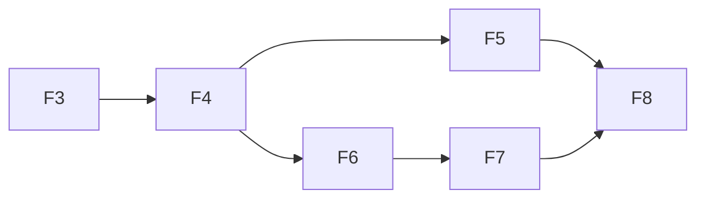

# Plan de implementación — Copiloto de la mascota (frontend)

> **Qué es:** el desglose ejecutable de [`plan-copiloto-alkimia.md`](plan-copiloto-alkimia.md), con tareas, ficheros, tests y criterio de «hecho».
> **Contrato vigente:** `doc/contrato-api/assistant/assistant-frontend.md` §3.2 y `doc/contrato-api/assistant/mascota-frontend.md` §1.1. Las fases B0–B3 del backend están implementadas; la B4 (retirada de `uiActions`) sigue pendiente.
> **Regla para cada fase:** se entrega en su propia rama/PR con `npm run build`, `npm run lint` y `npm test -- --include=src/app/features/assistant/**` en verde. El modelo antiguo (`uiActions` + `pendingAction` por el endpoint bloqueante) **sigue funcionando hasta F8**.
> **Estado: TERMINADO (2026-11-07).** Las ocho fases F0–F8 están hechas. Lo único que queda fuera del frontend es la **B4 del backend** (dejar de emitir `uiActions` de navegación), pedida en `doc/contrato-api/assistant/assistant-b4-retirar-uiactions-peticion.md`; no bloquea nada porque lo que llegue se ignora.
>
> **Re-baseline:** 2026-11-07, con F0, F1 y F2 cerradas. Lo que sigue parte del código que hay hoy en `src/app/features/assistant/`, no del plan original.

---

## 0. Dónde estamos de verdad

### 0.1 Fases cerradas

| Fase | Estado | Qué quedó en el árbol |
|---|---|---|
| **F0** Contratos y specs | ✅ hecho | `doc/contrato-api/assistant/{assistant,mascota}-frontend.md` alineados con `tus-dietas`; la regla «nada se escribe sin un sí explícito» en `PRODUCT.md` y en `src/app/features/assistant/SPEC.md`. |
| **F1** Transporte | ✅ hecho | `AssistantStreamRequest { content, attachmentId, clientTools, pageContext }`, eventos `client_tool` y `stopped` en el parser SSE, `postToolResult` (`accepted` \| `ignored` \| `gone`), `stopRun`, `latestSession(subjectUserId)`. En `MascotStateService`: `activeRunId`, `clientSteps`, `stop()` y la liberación del turno colgado. |
| **F2** Catálogo y contexto | ✅ hecho | Todo `copilot/`: `tool-registry.service.ts`, `tool-runner.service.ts`, `schema.ts`, `catalog-rules.ts`, `tool-names.ts`, `page-context{,.service}.ts`, `step-limiter.service.ts`, `confirmation.service.ts`, `tools/echo.run.ts`. En el descriptor: `FillField.people` y `FillSurface.contextual()`. |

Verificación acumulada: `ng test` 423 SUCCESS, `ng build` OK, eslint limpio, `spec_validate` sin problemas. **Nada de esto se ha probado contra el backend real** — ver D3.

### 0.2 Lo que se desvió del plan original (y por qué)

Estas desviaciones son decisiones tomadas, no deuda. Importan porque F3–F8 parten de ellas.

| # | Plan original | Lo que hay | Por qué |
|---|---|---|---|
| Δ1 | `confirm_action` en F4 | hecho en F2 (`copilot/confirmation.service.ts`) | El backend la emite solo y, si nadie contesta, **rechaza** la acción. Sin ella toda escritura de servidor por streaming se perdía en silencio. |
| Δ2 | Las listas van como `array` de `object` | van como `array` de cadenas | Un array de objetos pasa de los 3 niveles de profundidad que acepta el validador del backend. |
| Δ3 | `choice` → `enum` siempre | los `choice` de personas no se enumeran (`FillField.people`) | Los nombres de pacientes acabarían en el prompt, y en un buscador la lista son solo los últimos resultados. |
| Δ4 | Descripciones de campo desde i18n (`assistant.fields.*`) | solo hints de formato (`Número`, `Fecha YYYY-MM-DD`) | Cabe sin gastar el presupuesto de 2 KB y evita mantener 15 bloques de i18n que el modelo apenas usa. |
| Δ5 | Partir el esquema por `reveal` | `fillTools()` parte en `fill_x`, `fill_x_2`… | Ninguna de las 15 surfaces reales lo necesita (las mayores: `patient_profile` 1,6 KB, `measurement` 1,4 KB). El mecanismo existe por si entra una grande. |
| Δ6 | `step-limiter.ts` (función) | `StepLimiter` (servicio, `used` como signal) | La barra de F6 tiene que pintar «Paso n/30», y un signal es lo que consume. |
| Δ7 | Las herramientas de formulario se declaran siempre | solo con `localStorage['mascot-debug-screen-tools']='1'` | En F2 se declaraban pero no se sabían ejecutar: ofrecerlas habría roto turnos reales. **F3 quita el flag.** |

### 0.3 Deuda abierta de F0–F2

| # | Deuda | Dónde se paga |
|---|---|---|
| **D1** | No hay panel de depuración del catálogo (la tarea 2.8 del plan original). Hoy el catálogo solo se inspecciona por `console.warn` de `catalog-rules`. | F3.0 |
| **D2** | **Cero** `data-mascot-point` y **cero** `data-mascot-submit` en la aplicación. `data-mascot-field` hay 22, en tres pantallas (ficha de paciente, tipos de cita, dirección del centro). | F4.3 y F5.1 — es trabajo de marcado real, no accesorio |
| **D3** | Ninguna de las tres fases está verificada contra el backend real. El transporte completo (`client_tool` → `tool-results` → `delta`) solo se ha probado con dobles. | F3.0, antes de escribir herramientas nuevas |
| **D4** | `FillReport` solo lleva `written` y `missing`: no sabe decir qué rechazó el formulario. | F3.1 |
| **D5** | No existen `FillField.long` ni `FillSurface.noSave`. | F3.5 y F5.1 |
| **D6** | `ToolFailure` solo tiene tres razones (`unknown_tool`, `tool_error`, `step_budget_exhausted`). Faltan las de las herramientas que llegan ahora. | F3.0 |

---

## 1. Mapa de fases restantes

| Fase | Entrega | Est. | Depende de |
|---|---|---|---|
| **F3** | Formularios con resultado: `fill_`, `open_`, `navigate`, `edit_` | 9 d | — (F2 cerrada) |
| **F4** | Preguntar y señalar: `ask_user`, `point_at`, `show_around`, `press`, `action_` | 7 d | F3 |
| **F5** | `save_` con confirmación y `X-Assistant-Write` | 5 d | F4 |
| **F6** | Barra inferior en lugar del panel | 12 d | F4; en paralelo a F5 |
| **F7** | Vida y encanto | 8 d | F6 |
| **F8** | Retirada del modelo antiguo y cierre de specs | 2 d | F5 y F7 |

**Todas hechas.** Queda abierta la deuda **D3**: nada de F3 a F5 se ha probado de punta a punta
contra el backend real, con el modelo llamando a `fill_` y `save_` y leyendo el resultado. F8 ha
retirado el camino antiguo, que era lo único verificado contra el servidor, así que esa prueba ya
no tiene red debajo.
| | | **≈ 43 d (≈ 8–9 sem)** | |

F4 baja de 8 a 7 días porque `confirm_action` ya está (Δ1), pero sube por el marcado de D2. F3 sube de 8 a 9 por D1, D3, D4 y D6.



### Estructura de carpetas objetivo

```
src/app/features/assistant/
  copilot/                        ← existe desde F2
    client-tool.model.ts          ✅  tool-registry.service.ts  ✅
    tool-runner.service.ts        ✅  schema.ts                 ✅
    catalog-rules.ts              ✅  tool-names.ts             ✅
    page-context{,.service}.ts    ✅  step-limiter.service.ts   ✅
    confirmation.service.ts       ✅  tools/echo.run.ts         ✅
    question.service.ts           F4: la bandeja común de preguntas
    pointing.ts                   F4: data-mascot-point, resolvePointable, isDangerous
    text-edit.ts                  F3: port puro de alkimia textEdit.ts
    cursor.service.ts             F6: pausar / reanudar
    assistant-write.interceptor.ts F5: X-Assistant-Write
    route-veil.ts insert-reveal.ts F7
    tools/
      fill.run.ts  open.run.ts  navigate.run.ts  edit.run.ts     F3
      ask.run.ts   point.run.ts tour.run.ts      press.run.ts
      action.run.ts                                              F4
      save.run.ts                                                F5
  bar/                            F6
  components/  mascot/            existentes
```

---

## F3 — Formularios con resultado (9 d)

Objetivo: que el modelo pueda rellenar lo que hay en pantalla, abrir un diálogo, cambiar de pantalla y editar un texto largo, **y leer el resultado de cada cosa**. Al final de la fase se quita el flag de depuración y las herramientas de formulario pasan a declararse de verdad.

| # | Tarea | Ficheros | Detalle |
|---|---|---|---|
| 3.0 | **Cerrar la deuda de F2 antes de añadir nada** | `copilot/client-tool.model.ts`, `components/mascot-panel.html` | Ampliar `ToolFailure` con `surface_gone`, `user_declined`, `control_gone`, `control_disabled`, `opened_dialog`, `not_found`, `ambiguous` (D6).<br>Panel de depuración detrás de `localStorage['mascot-debug-catalog']`: lista el catálogo del turno, el `pageContext` que se mandó y los pasos gastados (D1).<br>**Prueba contra el backend real** del ciclo `echo`: catálogo → `client_tool` → `tool-results` → `delta` → `done`, y el caso de detener a mitad (D3). Sin esto, los fallos de F3 no se podrán atribuir. |
| 3.1 | `fill_<id>` | `copilot/tools/fill.run.ts`, `mascot/fill/animated-fill.ts` | Relee la surface montada en el momento de la llamada; si ya no está, `surface_gone`. Espera a `ready()` con tope de 3 s.<br>Reutiliza `playFill` ampliando `FillReport` (D4) con `rejected: { field, reason }[]` —valor no parseable, opción inexistente, o control que tras escribir no tiene ese valor— y `missingRequired`, leído de los `Validators.required` del `FormGroup`.<br>Responde `{ ok, written, missing, rejected, missingRequired }`.<br>Honra el `AbortSignal` del `ToolContext`: al detener, deja lo escrito donde esté y responde con lo hecho hasta ahí. |
| 3.2 | Marca de «escrito por la mascota» | `animated-fill.ts`, `styles.less` | `data-mascot-written` en el campo hasta que la persona lo edite (`input` de usuario). Estilo con token `--mascot-written`, un subrayado verde suave de `design-guide`. |
| 3.3 | `open_<id>` | `copilot/tools/open.run.ts` | Sobre el `FillOpener` que ya existe. Espera a que la surface se registre (`waitForTool`, 3 s). Responde `{ ok, opened: id, clientTools }` con el catálogo nuevo. |
| 3.4 | `navigate` | `copilot/tools/navigate.run.ts`, `mascot/fill/surfaces/routes.ts` | `{ screen: enum, params }`, con la lista blanca de `resolveFillRoute` pasada a `enum` en el esquema. Espera entre 250 ms y 2 s al cambio de ruta y al registro de surfaces.<br>Responde `{ ok, route, clientTools }`. Cierra el panel si tapa la pantalla, como hoy. |
| 3.5 | `edit_<id>` | `copilot/text-edit.ts`, `copilot/tools/edit.run.ts`, `mascot/fill/descriptor.ts` | Añade `FillField.long?: boolean` (D5). Solo se genera `edit_` para surfaces que tengan algún campo largo: notas de cita, observaciones del paciente, anamnesis y descripción de plantilla.<br>Operaciones: `append`, `prepend`, `insert_after`, `insert_before`, `replace`, `delete`. Si el fragmento no aparece o aparece dos veces → `not_found` / `ambiguous`.<br>`text-edit.ts` es un port puro, con sus tests portados. |
| 3.6 | Convivencia con `pendingAction` | `mascot-state.service.ts` (`offerAction`) | Mientras exista el camino bloqueante, un `done` con `pendingAction` sigue disparando el autorrelleno de siempre. Lo que no puede pasar es que un turno rellene **dos veces**: si el turno ya ejecutó un `fill_` para esa surface, `offerAction` no vuelve a rellenar y solo ofrece la tarjeta. |
| 3.7 | Quitar el flag | `copilot/tool-registry.service.ts` | Se borra `SCREEN_TOOLS_KEY` y las herramientas de formulario se declaran siempre (Δ7). Es lo último de la fase: hasta aquí todo se prueba con el flag puesto. |

**Tests**
- `fill.run.spec.ts`: surface desaparecida, `ready()` que tarda, campo rechazado, requerido que falta, aborto a mitad.
- `text-edit.spec.ts` (port) y `edit.run.spec.ts`: `not_found` y `ambiguous`.
- `navigate.run.spec.ts`: ruta fuera de la lista blanca, y el catálogo nuevo en la respuesta.
- `open.run.spec.ts`: el diálogo no llega a abrirse.
- `tool-registry.service.spec.ts`: sin el flag, las 15 surfaces montadas se declaran y ninguna la descarta `declProblem`.
- `mascot-state.*.spec.ts`: no hay doble relleno (3.6).

**Hecho cuando:** desde el panel principal, «apunta 70 kg a Ana» abre la ficha, navega, rellena y el modelo cuenta en su respuesta lo que escribió y lo que no — contra el backend real, sin flags de depuración.

---

## F4 — Preguntar y señalar (7 d)

`confirm_action` ya existe (Δ1). Lo que falta es que la mascota pueda **preguntar algo que no sea una escritura**, señalar la pantalla y pulsar controles. Esta fase trae el marcado de D2, que es trabajo repartido por muchas pantallas.

| # | Tarea | Ficheros | Detalle |
|---|---|---|---|
| 4.1 | Bandeja común de preguntas | `copilot/question.service.ts`, `copilot/confirmation.service.ts` | Una sola cola de «la mascota espera una respuesta», con `waiting` como signal y una Promise por pregunta. `ConfirmationService` pasa a apoyarse en ella en vez de llevar la suya: así la barra de F6 tiene un único sitio del que pintar, y dos preguntas no se pisan.<br>Al detener el turno, todo lo que espera se resuelve con `user_declined`. |
| 4.2 | `ask_user` | `copilot/tools/ask.run.ts` | `{ question, options?: string[], multiline?: boolean }`. Con `options` se pintan como respuestas rápidas (`mascot-quick-replies` ya existe); sin ellas, un campo de texto. Responde `{ ok: true, answer }` o `{ ok: false, reason: 'user_declined' }`.<br>Tope de 15 min, igual que `confirm_action`. |
| 4.3 | Marcado `data-mascot-point` | agenda, ficha de paciente, menús, ajustes | D2: hoy hay cero. Se marcan los controles útiles de esas cuatro áreas —no todos los botones— y se documenta la convención en `SPEC.md`. Es la tarea más larga de la fase. |
| 4.4 | `pointing.ts` | `copilot/pointing.ts` | `resolvePointable(id)` (visible, habilitado, dentro del diálogo activo si lo hay) e `isDangerous(el)` (borrar, descartar, cancelar, dar de baja). Función pura sobre el DOM, con tests de jsdom. |
| 4.5 | `point_at` | `copilot/tools/point.run.ts` | Lleva la mascota al control y lo resalta (`playHighlight`, ya existe). No pulsa. Responde `{ ok, label }` o `control_gone`. |
| 4.6 | `show_around` | `copilot/tools/tour.run.ts` | Una lista de paradas: cada una señala y dice una frase. Entre paradas se puede detener. Responde `{ ok, stops: n }`. |
| 4.7 | `press` | `copilot/tools/press.run.ts` | Solo pulsa lo que tenga `data-mascot-point`. Si `isDangerous`, pregunta antes por la bandeja de 4.1.<br>**Si la aplicación abre su propio diálogo de confirmación, la mascota no lo pulsa:** responde `opened_dialog` y la decisión queda en la persona. Esta regla se prueba explícitamente. |
| 4.8 | `action_<id>` | `copilot/tools/action.run.ts`, `mascot/fill/mascot-fill.service.ts` | `registerAction(id, { description, run })` para acciones propias de una pantalla: marcar cita como realizada, duplicar menú, activar recordatorios. Se declaran como el resto del catálogo y pasan por `declProblem`.<br>Las que escriben en el backend llevan `confirm: true` y pasan por la bandeja. |

**Tests**
- `question.service.spec.ts`: dos preguntas encoladas, resolución por detener.
- `ask.run.spec.ts`, `point.run.spec.ts`, `tour.run.spec.ts`.
- `press.run.spec.ts`: sin `data-mascot-point` no se pulsa; peligroso sin sí no se pulsa; diálogo propio → `opened_dialog`.
- `pointing.spec.ts`: oculto, deshabilitado, fuera del diálogo activo.

**Hecho cuando:** «agéndale revisión a Ana el martes a las 10 y márcala como primera visita» se completa en un turno: navega, abre, rellena, pregunta lo que falta, confirma la escritura en la tarjeta y lo cuenta.

---

## F5 — `save_` con confirmación (5 d)

**Cambio de producto ya recogido en F0:** la mascota puede pulsar Guardar, pero **solo después de un sí explícito en su propia tarjeta**. El backend sigue validando y los permisos no cambian.

| # | Tarea | Ficheros | Detalle |
|---|---|---|---|
| 5.1 | Marcado y exclusiones | formularios de las 15 surfaces, `mascot/fill/descriptor.ts` | `data-mascot-submit="<id>"` en el botón de guardar de cada formulario (D2: hoy hay cero).<br>`FillSurface.noSave?: boolean` (D5). Lista inicial de exclusiones: **estado clínico, baja de paciente, y facturación y precios**. En esas surfaces no se declara `save_`. |
| 5.2 | `save_<id>` | `copilot/tools/save.run.ts` | 1) Busca `data-mascot-submit="<id>"`, con heurística de reserva dentro del formulario o del diálogo. 2) Señala el botón y pregunta por la bandeja de F4.1, con el resumen de lo que se va a guardar. 3) Pulsa solo con un sí. 4) Vigila 4 s: si el diálogo se cerró, si salió un error o si el botón quedó deshabilitado sin `aria-busy`. 5) Responde `{ ok, saved, errors[] }`. |
| 5.3 | El sí ya ejecutado | `copilot/tools/save.run.ts` | Si la persona pulsa Guardar mientras se le pregunta, eso cuenta como sí: la pregunta se cierra y la herramienta responde `saved` sin volver a pulsar. |
| 5.4 | `X-Assistant-Write` | `copilot/assistant-write.interceptor.ts`, `app.config.ts` | Las peticiones salidas de una herramienta llevan `X-Assistant-Write: <sessionId>` (solo trazabilidad). La ventana la abre `ToolRunnerService.running`, que ya existe. Va **antes** de `errorInterceptor` en la cadena.<br>Un test comprueba que una petición de la persona, fuera de la ventana, no lleva la cabecera. |
| 5.5 | Specs | `PRODUCT.md`, `src/app/features/assistant/SPEC.md` | Dejar escrito el resultado: qué formularios tienen `save_`, cuáles no y por qué. `spec_validate` en verde. |

**Tests**
- `save.run.spec.ts`: no se pulsa sin sí; no se atraviesa un diálogo de confirmación; `noSave` no declara la herramienta; el guardado que falla devuelve `errors`.
- `assistant-write.interceptor.spec.ts`.

**Hecho cuando:** «registra la medición y guárdala» pide el sí, guarda, y la petición lleva la cabecera; y la baja de un paciente no ofrece `save_` ni por asomo.

---

## F6 — Barra inferior (12 d, en paralelo a F5)

**Antes de programar:** mockup HTML en `.thinkrail/context/mockups/mascot-bar.html` con tres estados (reposo, trabajando con «Paso 3/30», preguntando) y aprobación de diseño. Debe seguir `design-guide`: neutros cálidos, verde `#2F5D4F`, Inter.

| # | Tarea | Ficheros | Detalle |
|---|---|---|---|
| 6.0 | Investigación del foco | — | Un `tui-dialog` atrapa el foco: comprobar que la barra sigue respondiendo con un diálogo abierto. Si no, decidir la salida (`tuiDialog` con `closeable:false` y foco delegado, o portal fuera del overlay) **antes** de 6.1. |
| 6.1 | `MascotBar` | `bar/mascot-bar.ts` | Anclada abajo y centrada, ancho máximo 640 px. En móvil sobre `--bottom-nav-h`. La mascota se acopla en el extremo izquierdo y sustituye al FAB: **una sola mascota en pantalla**. |
| 6.2 | Línea de estado | `bar/strip-kind.ts`, `bar/bar-strip.ts` | `stripKind()` puro, portado. Prioridad: `confirm` > `choice` > `paused` > `acting` > `thinking` > `reply`. Pinta «Paso n/30» desde `StepLimiter.used` y las preguntas desde `QuestionService`. |
| 6.3 | Entrada | `bar/bar-input.ts` | `textarea` que crece hasta 4 líneas; Enter envía, Shift+Enter salta. Adjuntos y soltar archivos (ya existen), borrador en `state.draft`, y botón que cambia a Detener mientras trabaja. |
| 6.4 | Bandeja de lectura | `bar/reading-doc.ts`, `bar/bar-tray.ts` | `readingDoc(markdown)` puro. Una respuesta de 120 palabras o más, o con títulos, se abre en la bandeja con secciones numeradas; `mascot-rich-text` se amplía con `#`/`##` y listas.<br>La bandeja lleva también el historial, con las filas `TOOL` del backend como chips («Rellenó: peso, cintura»): hay que añadir `role: 'TOOL'` a `MascotMessage`. |
| 6.5 | Cola | `bar/bar-queue.ts`, `mascot-state.service.ts` | Lo enviado mientras `sending()` va a `queued: signal<string[]>`. Cada elemento se puede quitar o usar con «Hacer ahora», que hace `stop()` y lo envía. Al terminar un turno se envía el siguiente. |
| 6.6 | Pausa | `copilot/cursor.service.ts` | `paused` como signal y `whenResumed()` como Promise. Los runners esperan entre pasos: entre campos en `fill_`, entre paradas en `show_around`, antes de pulsar en `press` y `save_`. |
| 6.7 | Convivencia | `layout/shell`, `MascotPreferencesService` | La barra entra detrás de la preferencia temporal `mascot.bar`. El panel antiguo sigue funcionando hasta F8. |

**Tests:** `strip-kind.spec.ts`, `reading-doc.spec.ts` (port), `bar-queue.spec.ts`, `cursor.service.spec.ts`, `mascot-bar.spec.ts` (cambio de estados y pregunta con foco).

**Hecho cuando:** el flujo de la cita de F4, con pausa a mitad y un segundo mensaje en cola, se hace entero sin el panel antiguo, en escritorio y en móvil (375 px).

---

## F7 — Vida y encanto (8 d)

| # | Tarea | Ficheros | Detalle |
|---|---|---|---|
| 7.1 | Velo de ruta | `copilot/route-veil.ts` | Cuando `navigate` cambia de pantalla: fundido de 180 ms y revelado de 220 ms. Con `reduced-motion`, sin velo. |
| 7.2 | Seguir entre pantallas | `mascot/mascot-follow.ts` | Al cambiar de sección (`NavigationEnd`), mira la entrada del menú, se agacha y salta. Sobre `motionCore`, que ya existe. |
| 7.3 | Colocación | `mascot/placement.ts` | No tapa toasts (`tui-alert`), ni el diálogo, ni el campo en el que trabaja. Con `--toast-clear-*`. |
| 7.4 | Filas en cascada | `copilot/insert-reveal.ts` | En surfaces con `lists` (los tramos de un horario), las filas nuevas entran una a una con `data-mascot-new`. |
| 7.5 | Primeros pasos | `mascot/first-steps.ts` | La primera vez: tres ofertas (crear cita, registrar medición, generar menú) que **escriben el borrador, no lo envían**. Se recuerda en `MascotPreferencesService`. |
| 7.6 | Modo héroe | `mascot/mascot-hero.ts`, `skins/heroes.ts` | Easter egg (triple clic con Alt). Un disfraz y un efecto por skin. Desactivable en preferencias (`heroEnabled`). |
| 7.7 | Personalidades | `skins/personalities.ts` | Reacciones `blush` / `angry` / `cheer` diferenciadas por skin. |
| 7.8 | Secretos de consola | `mascot/mascot-secrets.ts` | `window.nuti.*` y la paloma, **solo con `!environment.production`**. |

**Descartado:** `mascotKnock`, `go_to_app` y el dictado por voz.

**Hecho cuando:** cada pieza tiene test de su función pura y una comprobación manual con `reduced-motion` activado.

---

## F8 — Retirada y cierre (2 d)

| # | Tarea |
|---|---|
| 8.1 | Quitar el tratamiento de `NAVIGATE`, `OPEN_DIALOG` y `HIGHLIGHT` en `handleUiActions`. `TOAST` se queda. |
| 8.2 | Quitar el autorrelleno desde `pendingAction` (`offerAction` → `playFill`) y el `routeForTool` de `surfaces/routes.ts`, que ya cubre `navigate`. Con ello cae también la convivencia de F3.6. |
| 8.3 | Borrar `components/mascot-panel.*`, la preferencia temporal `mascot.bar` y `copilot/tools/echo.run.ts` con su flag. |
| 8.4 | Avisar al backend para que haga la **B4** (retirada de `uiActions`). |
| 8.5 | Actualizar `assistant-module`, `assistant-contract` y `mascota-contract`; marcar este plan y `plan-copiloto-alkimia.md` como hechos; borrar `doc/mascot-improvement-plan*.md` si aún queda alguno. |

---

## 2. Riesgos a vigilar

| Riesgo | Dónde se nota | Mitigación |
|---|---|---|
| **Nada se ha probado contra el backend real** | F3 en adelante | D3 es la primera tarea de F3. Un fallo de transporte descubierto en F5 cuesta tres fases de depuración. |
| El marcado del DOM (`data-mascot-point`, `data-mascot-submit`) está a cero | F4 y F5 | Está presupuestado como tarea propia (4.3 y 5.1), no como «un atributo de paso». |
| Un esquema de más de 2 KB o un nombre con guion se descarta **en silencio** | F3 | Ya hay validación en cliente con las reglas del backend y `console.warn`; el panel de 3.0 lo hace visible. |
| El modelo `flash-lite` encadena mal tareas largas | F3 y F4 | Telemetría del backend (`repeated_call`, `step_budget_exhausted`). Descripciones cortas y en imperativo. |
| Coste en tokens del `pageContext` en cada turno | F3 | Medir con 5 conversaciones tipo en cuanto haya backend real. Si se dispara, bajar el presupuesto de 22 000 a 12 000. |
| Un `tui-dialog` atrapa el foco y la barra no responde | F6 | La investigación 6.0, antes de construir nada. |
| Guardar algo erróneo | F5 | Siempre un sí explícito, nunca se atraviesan diálogos de confirmación, lista de exclusiones y trazabilidad por `X-Assistant-Write`. |

## 3. Comprobación de cada PR

1. `npm run build`
2. `npm run lint`
3. `npm test -- --include=src/app/features/assistant/**` (y los módulos tocados)
4. `spec_validate` si se tocó un `SPEC.md`, `PRODUCT.md` o un contrato
5. **Una pasada manual contra el backend real** del flujo de la fase, con la cuenta de nutricionista
